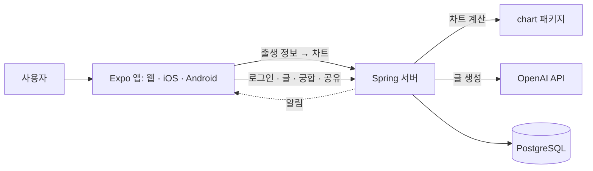

# 앱 아키텍처

> 상태: 활성 · 기준 2026-11-11 · 구조·의존 규칙 결정: docs/decisions/017-dev-session-and-boundaries.md. 코드가 생기면 `docs/codebase-map.md` 가 진입점을 맡는다.

## 구성


## 저장소 구조
- 앱 저장소(이 저장소) — Expo 앱과 기획 문서. Expo 규칙은 `AGENTS.md`.
- 서버 저장소 `byeolmyeong-api`(로컬 `../byeolmyeong-api`) — Spring Boot(Kotlin) 서버. API 계약의 원본은 그 저장소의 `docs/architecture.md` 다.
- 두 저장소는 HTTP API 로만 만난다.

## 앱이 하는 일과 하지 않는 일
- 한다: 입력 받기, 서버가 준 차트·글을 그리기, 로그인 흐름, 공유·알림 연결, 받은 결과를 기기에 보관.
- 하지 않는다: 차트·별자리·하우스·변곡점 구간·궁합 점수 계산, 글 생성, 만 14세 판정. 전부 서버가 한다. 결정: docs/decisions/006-server-side-chart.md

## 디렉터리 구조 (src/)
```
app/                 화면(Expo Router, 파일이 곧 라우트). 화면은 얇게: features 의 훅·부품을 조립만 한다
  _layout.tsx        루트: 글꼴 · 강제 업데이트 문 · 로그인 전 가드(features/auth/guard.ts — 로그인 전 · 소개 안 봄 /intro, 로그인 전 /login, 가입 중 /signup/terms(가입 단계와 이용약관 · 개인정보 수집 · 이용 동의 · 처리방침 · 마케팅 수신 동의 약관은 열림), /s · /auth 는 열림, 결정 034 · 042) · 스플래시(웹은 components/splash-view.tsx 를 그리고 앱은 네이티브 스플래시를 둔다 — 글꼴 · 세션 · 소개 기록 확인이 끝나 보낼 곳에 간 뒤 걷는다, 웹은 최소 0.8초, 결정 067) · 약관 글 네 화면은 아래에서 올라오는 창(Stack.Screen 옵션 components/slide-up.ts, 결정 067)
  index.tsx          홈 v2(별명 카드 · 아래 탭 넷, 결정 047 · 055. 출생 정보가 없으면 입력 · 서버의 것으로 되살리기)
  intro.tsx · login.tsx · auth/kakao.tsx   소개 2장(이 기기에서 처음 한 번, 결정 055) · 로그인(공급자 버튼 — 서버를 기다리는 동안 이 화면에 머물고 누른 버튼에 돌기, 결정 067) · 카카오 웹 로그인에서 돌아오는 화면(스플래시 모양으로 기다린다, 결정 034 · 042 · 067)
  signup/            단계식 가입(결정 042): terms.tsx(약관 동의) → nickname.tsx(닉네임 · 프로필) → birth.tsx(출생 정보, 여기서 POST /auth/signup 한 번)
  reading.tsx · report.tsx · direction.tsx · chart/(index 내 하늘 지도 · detail 차트 자세히 표) · synastry/(1.0.0 에서는 _layout.tsx 가 모든 주소를 홈으로 보낸다, 결정 055) · s/[shareId].tsx · my.tsx(마이: 출생 정보 · 도움 · 약관 · 정보 · 로그아웃 · 계정 삭제, 결정 038) · settings/(자주 묻는 질문 · 문의하기 · 처리방침 · 약관 · 마케팅 수신 동의 약관 · 개인정보 수집 · 이용 동의(privacy-consent — 약관 단계의 보기 · 동의하기, 결정 045) — 목록 화면은 없다. 약관 글은 결정 043)
features/            기능별 로직과 기능 전용 부품
  auth/              세션(session-store · use-session 의 useAuth — 소셜 로그인 · 가입 · 닉네임 확인 · 가입 그만두기 · 로그아웃, 개발용 세션), 공급자 버튼(providers/ — `google`·`apple`·`kakao` 의 기본(앱) · `.ios` · `.web` 파일, 같은 이름의 버튼, 모양은 social-button.tsx 하나 — 웹 구글은 같은 모양(SocialButtonFace) 위에 GIS 버튼을 투명하게 겹쳐 받는다, 결정 067), 최근 로그인(last-provider.ts — 마지막에 로그인한 공급자 이름만 AsyncStorage `byeolmyeong-device.lastProvider.v1`, 로그아웃 · 탈퇴가 지우지 않는다, 결정 044), 세션 토큰 보관, 로그인 전 가드(guard.ts), 가입 단계 뼈대(signup-step.tsx) · 초안(signup-draft.ts, 메모리만) · 닉네임 규칙(nickname-rule.ts) · 프로필 고르기 시트(avatar-sheet.tsx), 로그아웃(sign-out.ts — 기기 저장도 비움), 계정 삭제(확인 시트 · 기기 저장 비움)
  home/              홈의 별명 카드(nickname-card.tsx) · 계정의 닉네임 · 프로필(use-account.ts, `GET /account`) · 받은 지 며칠(days-since.ts, 한국 날짜) · 아래 탭 넷(main-tabs.tsx — 나 · 시기는 새 화면 전까지 /reading · /report?area=TIMING, 결정 046 의 4)
  onboarding/        소개 2장의 그림(intro-art.tsx)과 이 기기에서 봤는지(intro-seen.ts — AsyncStorage `byeolmyeong-device.introSeen.v1`, 로그아웃 · 탈퇴가 지우지 않는다, 결정 042)
  chart/             내 하늘 지도(휠 · "별마다 있던 자리" · 별 시트, 용어는 `strings.glossary`)·겹친 휠(궁합)·표·입력 폼과 출생 정보 세 칸(BirthFields) · 태어난 곳 시트(place-sheet.tsx — 검색 · 시 · 도 칩 → 시 · 군 · 구, 결정 042) (서버가 준 값만 그린다). 기기에 출생 정보가 없을 때 서버의 것으로 되살리기(use-birth-restore.ts, 결정 029)
  reading/           요약 해석 요청 상태·문단 부품 · 별명 짓는 중(making-view.tsx, 결정 042) · 별명 공개(reveal-view.tsx — 가입 직후 한 번, 값은 reading.tsx 가 풀이 · 차트 · 가입이 받은 닉네임(메모리)으로 채운다, 결정 044)
  report/            심층 리포트·변곡점 타임라인
  synastry/          궁합(직접 입력)·랭킹·궁합 리포트의 상태와 부품. 방금 계산한 궁합의 메모리 보관(fresh-synastry.ts). 궁합 지우기(delete-synastry.ts · 확인 시트 synastry-delete-sheet.tsx)
  direction/         방향성 제시(이성 · 미래 · 궁합)의 요청 상태·글 부품. 기기 보관은 이성만(결정 023 · 026)
  support/           자주 묻는 질문을 받아 오는 상태(use-faqs.ts, 메모리에만 5분) · 목록, 문의하기의 입력 확인(inquiry.ts) · 보내는 상태 · 종류 칩(결정 024 · 028)
  update/            강제 업데이트(결정 027 · 059)와 점검 안내(결정 030 · 060): 버전 비교 · 권유 판정(version.ts) · 셋의 판정(update-store.ts) · 루트를 감싸는 문과 바쁨 등록(update-gate.tsx) · 막는 화면(update-required.tsx · maintenance-notice.tsx) · 권유 창(update-suggest.tsx)
  share/             공유 카드(9:16, 서버가 준 card 만으로 그린다)·공유 버튼과 시트·공유 주소·이미지와 링크 보내기(앱 share-actions.ts, 웹 share-actions.web.ts)·공유 페이지의 카드 받기
components/          공용 부품(버튼·입력 줄·표·시트·가운데 창 Dialog·짧은 알림 Toast·뼈대 Skeleton·탭…, 상태: 실패 화면 StateScreen · 연결 끊김 띠 OfflineBanner, 브랜드 그림: 로고 · 별이 · 빛나는 모양 · 스플래시 SplashView, 아래에서 올라오는 창 slide-up.ts — 약관 글 TextPage 가 쓴다). 기능을 모른다
constants/theme.ts   디자인 값의 단일 출처
content/strings.ts   문구의 단일 출처
content/legal.ts     약관 · 처리방침 · 마케팅 수신 동의 약관의 글. 랜딩 app/data/legal.ts 와 같은 사본(결정 043)
lib/api.ts           서버 호출(세션 헤더 · 버전 헤더, 결과 종류)과 계약 타입 · lib/fixtures/ 응답 예시
lib/app-client.ts    이 앱의 플랫폼과 버전(expo 설정의 version). 웹은 null
```
- 기능 폴더 안에서 훅은 `use-<이름>.ts`, 부품은 `<이름>.tsx`, 테스트는 `__tests__/`.
- 화면을 렌더하는 테스트는 `src/__tests__/` 에 둔다. `app/` 안에 두면 라우트가 되고, `features/` 에 두면 `app` 을 import 해 의존 규칙에 걸린다.
- 다른 기능이 가져다 써도 되는 파일은 `eslint.config.js` 의 `SHARED_FEATURE_FILES` 에 적는다(지금: `chart/ChartWheel.tsx`, `auth/use-session.ts`).

## 의존 규칙 (결정 017 — `npx expo lint` 가 실패하면 위반이다)
| 규칙 | 이유 | 강제 |
|---|---|---|
| 공용(`components`·`constants`·`content`·`lib`, 그리고 `app`·`features`·`__tests__` 밖의 모든 `src/` 최상위 폴더)은 `app`·`features` 를 import 하지 않는다 | 공용이 기능을 알면 순환이 생긴다 | `import/no-restricted-paths` |
| `features/<A>` 는 다른 `features/<B>` 를 import 하지 않는다. 예외: `eslint.config.js` 의 `SHARED_FEATURE_FILES`(지금 `chart/ChartWheel.tsx`, `auth/use-session.ts`). `features/` 바로 아래에는 파일을 두지 않는다 | 기능 하나를 고칠 때 다른 기능이 깨지지 않게 | `import/no-restricted-paths` |
| `features` 는 `app` 을 import 하지 않는다 | 화면은 위, 기능은 아래 | `import/no-restricted-paths` |
| 서버 호출은 `lib/` 에서만 한다(`lib/api.ts`). 화면·기능은 `fetch`·`XMLHttpRequest`·`expo/fetch` 를 쓰지 않는다 | 세션 헤더·오류 처리를 한 곳에서 | `no-restricted-globals`·`-properties`·`-imports` |
| 색·글자·간격은 `constants/theme.ts`, 문구는 `content/strings.ts` 에서만 | 디자인·번역이 한 곳에서 바뀐다 | 리뷰 |
| 차트·변곡점·점수 계산을 앱에서 하지 않는다 | 서버가 계산한다(결정 006) | 리뷰 |

## 데이터 흐름
- 차트: 입력 → `POST /charts` → 받은 `Chart` 를 그리고 기기에 보관. 다시 열 때는 보관본을 쓴다.
- 세션(개발용): 개발 빌드(`EXPO_PUBLIC_DEV_SESSION=1`)는 앱이 켜질 때 `POST /auth/dev` 로 세션을 받는다(결정 017, 서버 결정 005). Vercel 배포(스테이징 · 운영)에는 켜지 않는다(결정 037). 공유 페이지(`/s/…`)에서는 받지 않는다(결정 025).
- 세션(소셜 로그인, 결정 034 · 서버 결정 021): 공급자에서 받은 자격 증명(ID 토큰, 카카오 웹은 인가 코드)을 `POST /auth/login` 에 보낸다. 계정이 있으면 세션, 처음 온 사람은 가입권을 받아 단계식 가입(`/signup/terms` → `/signup/nickname` → `/signup/birth`, 결정 042)을 밟는다. 앞 단계 값(약관 버전 · 동의 · 닉네임 · 프로필)은 메모리 초안에만 두고, 닉네임 중복은 "다음" 에서 `POST /auth/nickname-check` 한 번, 마지막에 출생 정보와 함께 `POST /auth/signup` 한 번 — 서버가 만 14세를 판정한다(미만 403 `UNDER_AGE`, 가입권을 지운다). 로그아웃은 `DELETE /auth/session`. 웹이 켜질 때는 `GET /auth/session` 으로 쿠키 세션이 살아 있는지 본다.
- 세션 토큰: 앱(iOS·Android)은 기기 보안 저장소에만 두고 요청마다 `Authorization: Bearer <token>` 헤더로 보낸다. 웹은 서버의 httpOnly 쿠키 `bm_session` 에 맡기고 모든 요청에 `credentials: 'include'` 를 붙인다(토큰을 받지도 두지도 않는다).
- 출생 정보: 입력 화면이 차트를 받은 뒤 세션이 있으면 `PUT /profile` 로 서버에도 저장한다. 요약 해석은 서버가 이 값으로 쓴다. 시각이 "모름"(`time: null`)이어도 태어난 곳 칸은 보이고(없어도 된다) `placeId: null` 을 보낸다(서버는 시각이 없으면 곳을 읽지 않는다). 골랐으면 곳은 기기에만 남는다(입력 칸을 채울 때 쓴다, 결정 042 — 020 의 "곳을 묻지 않는다" 대체).
- 출생 정보 되살리기(결정 029): 홈(`/`)이 기기 저장소를 읽었는데 출생 정보가 없고 세션 토큰이 있으면 `GET /profile` 을 한 번 부른다(`features/chart/use-birth-restore.ts`). 200 이면 그 입력으로 `POST /charts` 를 받고, 시각을 알면 `GET /places` 에서 `placeId` 의 이름을 찾아(못 찾으면 이름을 비워 두고 식별자만) 입력 화면과 같은 `saveBirth` 로 기기에 둔 뒤 홈을 그린다. `PUT /profile` 은 다시 하지 않는다. 확인하는 동안(세션을 기다릴 때 포함)에는 "불러오는 중이에요" 만 보인다. 404 `NO_PROFILE` · 그 밖의 실패 · 차트를 받지 못함이면 입력 화면이다. 기기에 출생 정보가 있거나 세션이 없으면 부르지 않고, 가짜 서버는 404 로 답한다. 공유 페이지에서는 하지 않는다(홈이 아니다). 글(풀이 · 리포트 · 방향성)은 따로 되살리지 않는다 — 그 화면들이 서버에 묻고 서버가 저장된 글을 준다.
- 글: 세션이 있어야 요청한다. 요약 해석(`POST /readings`, 본문 없음)은 바로 받아 출생 정보별로 기기에 보관하고, 다시 열 때는 보관본을 쓴다. 401 이면 세션을 한 번 다시 받는다. 리포트는 202 를 받은 뒤 상태를 확인하거나 알림으로 완성을 안다. 다 쓴 리포트도 기기에 보관해 바로 보여 주되, 시기의 "지금 나의 구간"(`timing.current`)은 서버가 그날 날짜로 만들므로 보관본의 `current.date` 가 기기의 오늘(한국 날짜)과 다르면 `GET /reports/me` 를 한 번 조용히 다시 부른다(결정 021). 시기 탭은 지금 · 올해 · 내년 · 앞으로 · 지나온 시기의 네 부분이다(결정 031). 앱은 서버가 준 날짜 글자를 비교해 나누고 묶기만 한다(`features/report/timing.ts`): 오늘(`current.date`, 기기 시계가 아니다)을 기준으로 지난 것 · 지금 걸친 것 · 올해 시작 · 내년 시작 · 내년 뒤로 나누고(`splitByNow`. 내년의 이름표는 `nextYearLabel` 한 곳에서 오늘의 해 글자로 만든다), 앞으로 · 지나온 시기의 목록에서는 "지금 앞뒤 10년" 을 먼저 거르고(`splitByWindow`) 시작한 해로 묶는다. 해 · 만 나이는 서버가 준 값만 적고, 앱이 셈한 "몇 년 뒤" 같은 숫자는 없다.
- 계정 삭제: 마이의 확인 시트(결정 038) → `DELETE /account`(204) → 성공했을 때만 기기 저장소에서 이 앱의 키(`byeolmyeong.` 으로 시작하는 것 전부)와 보안 저장소의 세션 토큰을 지우고 로그인 화면(`/login`, 결정 034)으로 간다. 로그아웃도 마이에서 하고 같은 곳으로 간다. 실패하면 기기의 것은 건드리지 않는다. 기능이 기기에 새로 두는 키는 `byeolmyeong.<이름>.v<판>` 으로 짓는다(그래야 삭제 때 함께 지워진다). 예외: 사람이 아니라 기기에 붙는 값(소개를 봤는지 — 결정 042, 마지막에 로그인한 공급자 이름 `byeolmyeong-device.lastProvider.v1` — 결정 044)은 일부러 `byeolmyeong-device.` 로 지어 로그아웃 · 탈퇴 뒤에도 남긴다.
- 방향성 제시(이성): `/direction` 을 열 때만 `POST /directions`(`{ topic: "LOVE" }`)를 부른다(결정 023). 요약 해석 화면과 홈은 부르지 않고 들어가는 줄만 둔다. 서버가 글을 기다렸다 답해 처음에는 20초쯤 걸린다(그동안 기다리는 화면). 받은 글은 요약 해석과 같은 모양의 키(출생 정보별)로 기기에 두고(`features/direction/use-direction.ts`), 있으면 세션을 기다리지 않고 바로 보여 준다. 404 면 기기의 내 출생 정보를 `PUT /profile` 한 뒤 한 번만 더 요청하고, 502 는 "다시 시도" 를 보여 준다. 항목이 정확히 3개가 아니거나 근거가 빈 응답은 쓰지 않는다(`isDirection`).
- 방향성 제시(미래): 심층 리포트의 시기 탭이 보일 때만 `POST /directions`(`{ topic: "FUTURE" }`)를 부르고 탭의 "지금" 바로 아래에 그린다(결정 026 · 031). 다른 탭을 보는 동안에는 부르지 않는다. 화면 `app/report.tsx` 가 `features/direction` 의 칸(`FutureDirection`)을 `ReportView` 의 `timingAfterNow` 자리에 넣는다(기능끼리는 서로 가져오지 않는다). 글은 "지금의 시기" 가 같은 동안만 같고 바뀌는 날은 서버만 알므로 **기기에 두지 않고 보일 때마다 받는다**(저장된 글은 서버가 바로 준다). 기다리는 중 · 실패("다시 시도")는 그 칸 안에서만 보이고 시기의 나머지는 그대로다. 404 면 `PUT /profile` 뒤 한 번만 더 요청한다.
- 방향성 제시(궁합): 궁합 결과의 버튼을 눌러 `/synastry/<id>/direction` 을 열 때만 `POST /directions`(`{ topic: "SYNASTRY", synastryId }`)를 부른다(결정 026). 결과 화면은 부르지 않는다. 메모리에 상대의 출생 정보가 있으면(방금 계산한 궁합) 함께 보내고(`date` · `time` · 시각을 알 때만 `placeId`), 없으면 식별자만 먼저 보낸 뒤 `BIRTH_REQUIRED` 가 오면 화면에서 다시 입력받아 보낸다. `BIRTH_MISMATCH` · `INVALID_DATE` · `INVALID_TIME` · `UNKNOWN_PLACE` 는 다시 입력, `PROFILE_CHANGED` 는 궁합을 새로 보게 하고, `NOT_FOUND` 는 궁합 결과와 같은 안내다. 상대의 출생 정보도 받은 글도 기기에 두지 않는다.
- 방향성 제시(공통): 호출은 받은 글의 `topic` 이 요청한 주제일 때만 쓴다(`lib/api.ts` 의 `createDirection` · `createSynastryDirection`). 다르면 계약과 다른 응답(`INVALID`)이다.
- 궁합(직접 입력): `/synastry` 에서 관계 유형 · 부를 이름 · 상대의 출생 정보를 넣어 `POST /synastry/direct` 를 부른다(글을 기다렸다 답해 수십 초 걸린다. 그동안 기다리는 화면). 받은 결과의 겹친 휠(`overlay`)과 보낸 상대의 출생 정보는 **방금 계산한 것 하나만 메모리에** 둔다(`features/synastry/fresh-synastry.ts`). 기기 저장소에는 두지 않는다 — 서버도 저장하지 않는다(서버 결정 008). 앱을 다시 켜거나 다른 궁합을 계산하면 사라진다.
  - 결과 `/synastry/<id>`: 메모리에 있으면 그것으로(휠 있음), 없으면 `GET /synastry/{id}` 로(휠 없음) 그린다. 점수와 점수 옆의 말(`scoreLabel`)은 받은 그대로다.
  - 리포트 `/synastry/<id>/report`: `GET /synastry/{id}/report` 로 상태를 보고, 요청(`POST`)에는 상대의 출생 정보를 다시 보낸다 — 메모리에 있으면 그 값, 없으면 화면에서 다시 입력받는다. `BIRTH_MISMATCH` 는 다시 입력, `PROFILE_CHANGED` 는 궁합을 새로 보게 한다. 리포트의 글은 기기에 보관하지 않는다.
  - 랭킹 `/synastry/ranking` 과 지난 궁합 목록은 서버가 준 순서대로만 그린다.
  - 지우기: 결과 화면의 "이 궁합 지우기" → 확인 시트 → `DELETE /synastry/{id}`(204. 서버가 그 궁합의 리포트 · 방향성 글도 지운다. 공유 링크는 남는다). 성공했거나 이미 없으면(404) 메모리의 방금 계산한 결과가 그 궁합일 때 버리고(`forgetFresh`), 떠 있는 랭킹 · 지난 궁합 목록이 서버에서 다시 받게 알린 뒤(`features/synastry/delete-synastry.ts`. 앱이 줄을 골라 빼지 않는다) 화면을 `/synastry` 로 바꾼다(replace). 실패하면 시트에 안내를 적고 아무것도 바꾸지 않는다(다시 누를 때만 다시 요청). 지우는 곳은 결과 화면 하나다(목록 · 랭킹의 줄에는 없다).
  - 화면 조립은 `app/synastry/` 가 한다: 출생 정보 칸(`features/chart/birth-fields.tsx`)과 겹친 휠(`features/chart/overlay-wheel.tsx`)은 `chart` 의 것이고 `features/synastry` 는 이를 import 하지 않는다(의존 규칙).
- 문의하기(결정 024): `/settings/inquiry` 에서 종류 · 내용 · 답장 받을 이메일을 적으면 앱이 서버와 같은 규칙으로 먼저 확인하고(`features/support/inquiry.ts`: 종류 필수, 내용은 앞뒤 공백을 뗀 뒤 유니코드 코드 포인트로 10~2000자, 이메일은 비우거나 공백 없이 `@` 하나와 점 있는 도메인) `POST /inquiries`(`{ category, body, replyEmail }`, 이메일이 비면 `null`)로 보낸다. 201 `{ id }` 면 완료 상태를 보여 준다. 실패하면 안내만 보여 주고 적은 것은 그대로 둔다(스스로 다시 보내지 않는다). 429(한 계정에 한 시간 5번, 판정은 서버)는 "잠시 뒤 다시" 로 안내한다. 적은 내용과 이메일은 화면의 메모리에만 있다 — 기기 저장소와 로그에 두지 않는다.
- 자주 묻는 질문(결정 028): `/settings/faq` 를 열면 `GET /faqs`(세션 없이)로 `[{ id, question, answer }]` 를 받아 서버가 준 순서대로 그린다. 항목마다 비지 않은 글자 셋을 확인하고 하나라도 어긋나면 목록 전체를 받지 않는다(실패 안내와 "다시 시도"). 빈 목록이면 문의하기로 가는 줄을 보여 준다. 받은 목록은 메모리에만 5분 두고(`features/support/use-faqs.ts`) 기기에는 보관하지 않는다. 답은 그냥 글자로 그린다. 가짜 서버는 예시 두 줄(`lib/fixtures/faqs.json`)을 준다.
- 버전 헤더(결정 027): 네이티브 앱은 모든 요청에 `X-App-Platform: ios|android` · `X-App-Version: <expo 설정의 version>` 을 붙인다(`lib/app-client.ts` → `lib/api.ts`). 웹은 붙이지 않는다.
- 못 불러옴 · 연결 끊김(결정 061 의 1 · 3 · 4 · 065): 연결 상태는 `components/use-online.ts`(`@react-native-community/netinfo` — 네이티브 모듈이라 다음 개발 빌드에 들어간다, 모르면 연결된 것으로 본다). 화면 전체를 못 받으면 `StateScreen` — 끊긴 채(`NETWORK` 이고 오프라인)면 20-1("인터넷에 연결되어 있지 않아요" · 다시 시도), 서버가 끝내 못 썼으면 "다시 쓰기", 그 밖(연결은 됐는데 서버에 닿지 못함 포함)은 19("…을 불러오지 못했어요" · 다시 보기). 아래 탭은 남기고, 가입 직후 흐름에서는 머리 · 탭 없이(9-1 · 20-1). 받아 둔 것이 있으면 그대로 두고 위에 `OfflineBanner`. 연결이 돌아오면(`useOnReconnect`) 끊겨서 못 받은 것을 다시 받는다 — 리포트는 상태 확인(GET)만, 만들기(POST)는 사람이 누를 때만. 홈의 계정도 못 받았으면 다시 묻는다.
- 강제 업데이트(결정 027): 루트 레이아웃의 `UpdateGate`(`features/update`)가 앱이 켜질 때와 앞으로 돌아올 때(AppState `active`) `GET /app-config`(세션 없이)를 받아, 내 플랫폼의 `minVersion` 보다 내 버전이 낮으면 화면들(스택) 대신 막는 화면을 그린다(결정 059 의 3: 실패 화면 틀 `StateScreen` 의 "새 버전이 나왔어요", `message` 가 있으면 설명 대신 그 글, `storeUrl` 이 있으면 주 버튼 "업데이트", 없으면 설명 아래 안내 한 줄). 받지 못했거나 `minVersion` 이 null 이거나 읽을 수 없으면 막지 않는다. 웹과 가짜 서버에서는 막지 않는다(웹도 설정은 받는다 — 점검 때문에. 결정 030). 판정은 메모리에만 있다.
  - 바쁨: 화면이 `useGenerationBusy`(만드는 중 · 이 화면에서 방금 받은 결과) 나 `useUpdateBusy`(조건이 참인 동안)로 등록한다. 등록한 화면이 하나라도 떠 있으면 막는 것을 미루고, 그 화면이 사라지면 막는다. 등록하는 화면: `/reading` · `/report`(리포트 자체와, 시기 탭의 방향성(미래) 글을 기다리는 동안) · `/direction` · `/synastry` · `/synastry/<식별자>`(겹친 휠이 있을 때) · `/synastry/<식별자>/direction` · `/synastry/<식별자>/report` · `/settings/inquiry`(내용이나 이메일을 적어 둔 동안).
  - 권유(결정 059): 설정의 `latestVersion`(없는 옛 서버면 null)보다 내 버전이 낮고 `minVersion` 이상이면(`shouldSuggestUpdate`) 화면들 위에 가운데 창(`components/dialog.tsx`) "새 버전이 나왔어요" · "나중에" / "업데이트"(`storeUrl`)를 띄운다. 로그인한 홈(루트 레이아웃이 `canSuggest` 로 넘긴다)에서만 묻고 로그인 전 · 가입 중 · 다른 화면 · 바쁨 · 막음 · 점검 중에는 묻지 않는다. 같은 `latestVersion` 은 한 번만 — 창을 닫으면 그 버전을 기기 저장소 `byeolmyeong-device.updateAsked.v1` 에 적는다(기기에 붙는 값이라 로그아웃 · 탈퇴가 지우지 않는다 — 소개 기록과 같다). 웹 · 가짜 서버 · `storeUrl` 없음은 묻지 않는다.
  - 426: 어느 호출이든 426 `{ error: "UPDATE_REQUIRED" }` 를 받으면 `lib/api.ts` 가 등록된 처리기(`setUpdateRequiredHandler`)를 부르고, 문은 바쁨과 상관없이 바로 막는다(앱을 끌 때까지). 그 호출의 결과는 `SERVER` 실패(`status: 426`, `code: "UPDATE_REQUIRED"`)다.
- 점검 안내(결정 030 · 060): 같은 문이 같은 설정의 `maintenance: { active, message }` 를 본다(웹 포함. 키가 없는 옛 서버의 응답은 "점검 중이 아니다"). `active` 이면 화면들 대신 점검 화면(`features/update/maintenance-notice.tsx`: `StateScreen` 의 "지금 별명을 손보고 있어요", `message` 가 있으면 그 줄 다음 "끝나면 저절로 이어서 볼 수 있어요.", 버튼 없음)을 그리고, 업데이트 화면보다 먼저다. 점검 화면이 떠 있는 동안 60초마다와 앞으로 돌아올 때의 확인이 성공해 `active: false` 이면 스스로 풀려 화면들이 다시 그려진다. 확인이 실패하면 앞의 판정을 그대로 둔다. 바쁨은 강제 업데이트와 같이 미룬다.
  - 503: 어느 호출이든 503 `{ error: "MAINTENANCE" }` 를 받으면 `lib/api.ts` 가 등록된 처리기(`setMaintenanceHandler`)를 부르고, 문은 바쁨과 상관없이 바로 점검 화면을 그린 뒤 안내를 받으러 설정을 한 번 묻는다. 426 과 달리 붙박이가 아니다 — 그 뒤의 확인(60초마다 · 앞으로 돌아올 때)이 `active: false` 이면 풀린다. 다만 503 이 스스로 부른 그 한 번의 확인으로는 풀지 않는다(설정과 503 이 어긋날 때 풀렸다 막혔다를 되풀이하지 않게). 그 호출의 결과는 `SERVER` 실패(`status: 503`, `code: "MAINTENANCE"`)다.
  - 공유 페이지(`/s/…`)도 문 안에 있어 세션 없이 같은 화면을 본다.
- 공유(결정 025, 서버 결정 012): 화면의 "공유하기"(`features/share/share-entry.tsx`)가 시트를 열 때 `POST /shares` 를 부른다(화면을 여는 것만으로는 부르지 않는다). 본문은 `{ kind: "READING" }` · `{ kind: "SCORE", synastryId, myName }` · `{ kind: "RANKING", relation, showNames }` · `{ kind: "NEXT_TURN" }` 이고, 받은 `{ shareId, card }` 의 `card` 로 카드를 그리고 `shareId` 로 주소 `<웹 주소>/s/<shareId>` 를 만든다(웹 주소는 `EXPO_PUBLIC_WEB_URL`, 없으면 웹에서는 지금 주소의 origin, 둘 다 없으면 링크 버튼을 누를 수 없다).
  - 들어가는 곳: 요약 해석(`/reading`) · 궁합 결과(`/synastry/<id>`) · 궁합 랭킹(`/synastry/ranking`, 고른 관계 탭 · 줄이 있을 때만) · 리포트 시기 탭의 "앞으로", 다음 변곡점 카드 아래(다음 변곡점이 있을 때만. `features/report` 는 `share` 를 import 하지 않고 화면이 버튼을 넣어 준다).
  - 궁합 점수 카드는 시트가 먼저 "내 이름"(앞뒤 공백을 뗀 1~20자)을 받는다. 마지막 이름은 메모리에만 둔다. 랭킹 카드의 "이름 그대로 보이기" 는 꺼진 채로 시작하고 바꾸면 다시 요청한다. 이니셜은 서버가 만든다(앱은 이름을 줄이지 않는다).
  - 404 는 "공유할 것이 없다" 는 말만 보여 준다(다시 시도 없음). 요청한 종류와 다른 카드나 계약과 다른 모양은 쓰지 않는다(`isShareCard`).
  - 이미지: 앱은 카드 뷰를 `react-native-view-shot` 으로 1080×1920 PNG 파일로 만들어 `expo-sharing` 의 시스템 공유 시트로, 링크는 React Native `Share` 로 보낸다(버튼 둘). 웹은 `html2canvas-pro` 로 같은 크기의 PNG 를 내려받고 링크는 `expo-clipboard` 로 복사한다.
  - 공유 페이지 `/s/<shareId>`: 세션 헤더 없는 `GET /shared/{shareId}` 하나만 부르고 카드와 "나도 보러 가기"(`/` 로)만 보여 준다. 루트 레이아웃은 첫 경로 조각이 `s` 인 동안 세션을 시작하지 않는다(`useSession(false)`). 링크 미리보기의 제목 · 설명은 `generateMetadata()` 의 고정 문구다.
  - `Reading.shareId` 는 읽지 않는다. `DELETE /shares/{shareId}` 는 호출(`api.deleteShare`)만 있고 화면이 없다.
- 서버 오류의 이름: 실패 결과의 `code` 에 오류 본문 `{ error }` 의 값이 온다(`lib/api.ts`). 화면이 가려 쓰는 것은 `BIRTH_MISMATCH` · `PROFILE_CHANGED` 와 문의하기의 `INVALID_BODY` · `INVALID_EMAIL`, 로그인의 `EMAIL_REQUIRED`(알림 창), 가입의 `INVALID_NICKNAME` · `NICKNAME_TAKEN`(닉네임 단계로) · `TERMS_REQUIRED`(약관 단계로) · `UNDER_AGE`(생년월일 아래) · `SIGNUP_EXPIRED`(로그인으로)다.
- 서버가 준비되기 전에는 `lib/fixtures/` 의 응답 예시로 화면을 만든다.

## 비즈니스 룰 (앱이 지키는 것)
- 스플래시 직후 로그인을 받는다. 로그인 없이 열리는 화면은 공유 페이지뿐이다. 결정: docs/decisions/009-signup-first-kakao-age14.md (005 를 대체), 플랫폼별 방법은 docs/decisions/034-social-login-platforms.md. 개발 빌드는 개발용 세션으로 바로 들어간다(결정 017).
- 시각 "모름"이면 하우스·상승궁을 보여 주지 않는다.
- 초대로 연결된 궁합에서는 상대의 차트를 그리지 않는다. 서버가 상대의 위치를 내려주지 않는다.
- 직접 입력한 궁합 상대의 출생 정보와 겹친 휠 자료를 기기 저장소에 두지 않는다(메모리에만, 방금 계산한 것 하나). 궁합 점수 옆의 말은 서버가 준 것만 붙이고 앱이 점수 구간을 판정하지 않는다.
- 출생 정보와 세션 토큰을 로그·분석 이벤트에 남기지 않는다.
- 문의에 적은 내용과 답장 받을 이메일을 기기 저장소 · 로그에 남기지 않는다. 문의 메일 주소를 앱과 문서에 적지 않는다(결정 024).
- 자주 묻는 질문의 글을 앱에 싣지 않고 기기에 보관하지 않는다. 받은 답을 HTML · 마크다운으로 해석하지 않는다(결정 028).
- 기기에 출생 정보가 있으면 서버의 값으로 덮어쓰지 않는다. 되살리지 못해도 입력을 막지 않는다(결정 029).
- 궁합은 서버가 지웠다고 답한 뒤에만 화면에서 치운다(미리 지운 것처럼 그리지 않는다).
- 점검 안내는 확인하지 못하면 막지 않고, 점검이 끝나면 앱을 끄지 않아도 풀린다(결정 030).
- 강제 업데이트는 확인하지 못하면 막지 않고, 하던 일(만드는 중 · 방금 받은 결과 · 적어 둔 문의)을 끊지 않는다. 서버의 426 만 바로 막는다. 앱 버전을 시간 간격으로 다시 묻지 않는다(결정 027).
- 공유 카드와 공유 페이지에는 서버가 준 `card` 의 값만 그린다. 차트 · 출생 정보 · 근거 · 리포트 본문을 넣지 않는다. 궁합 점수 카드의 내 이름을 기기 저장소에 두지 않는다(결정 025).
- 알림 허용은 리포트 요청이나 초대 링크 생성 직후에만 묻는다.

## 관련
- 기능 명세: docs/release-1.0.0.md · 제품 방향: docs/product.md · 결정: docs/decisions/
