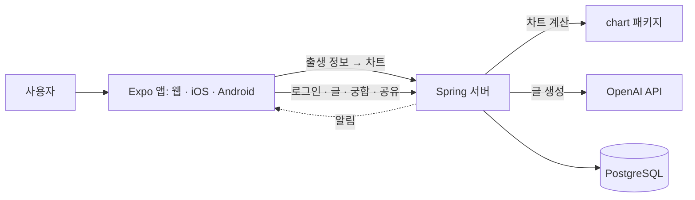

# 앱 아키텍처

> 상태: 활성 · 기준 2026-11-10 · 구현 전 설계다. 코드가 생기면 `docs/codebase-map.md` 가 진입점을 맡는다.

## 구성

## 저장소 구조
- 앱 저장소(이 저장소) — Expo 앱과 기획 문서. Expo 규칙은 `AGENTS.md`.
- 서버 저장소 `byeolmyeong-api`(로컬 `../byeolmyeong-api`) — Spring Boot(Kotlin) 서버. API 계약의 원본은 그 저장소의 `docs/architecture.md` 다.
- 두 저장소는 HTTP API 로만 만난다.

## 앱이 하는 일과 하지 않는 일
- 한다: 입력 받기, 서버가 준 차트·글을 그리기, 로그인 흐름, 공유·알림 연결, 받은 결과를 기기에 보관.
- 하지 않는다: 차트·별자리·하우스·변곡점 구간·궁합 점수 계산, 글 생성, 만 14세 판정. 전부 서버가 한다. 결정: docs/decisions/006-server-side-chart.md

## 모듈 경계 (src/)
- `app/` — 화면(Expo Router). 화면 목록은 docs/release-1.0.0.md "화면".
- `features/chart/` — 차트 휠과 표 그리기. 서버가 준 `Chart` 만 입력으로 받는다.
- `features/auth/` — 구글·애플·카카오 로그인, 만 14세 이상 확인, 세션 토큰 보관.
- `features/reading/` · `features/report/` · `features/synastry/` — 화면별 요청 상태와 표시.
- `components/` — 공용 부품(버튼, 입력 줄, 표, 도장, 시트).
- `content/` — 화면 문구와 처리방침·약관 문안.
- `lib/` — 서버 호출(`api.ts`)과 응답 예시(`fixtures/`).
- 의존 방향: `app` → `features` → `components`·`lib`·`content`. `features` 끼리는 서로 import 하지 않고 `chart` 의 그리기 부품만 예외로 쓴다.

## 데이터 흐름
- 차트: 입력 → `POST /charts` → 받은 `Chart` 를 그리고 기기에 보관. 다시 열 때는 보관본을 쓴다.
- 글: 로그인 뒤 요청. 요약 해석은 바로 받고, 리포트는 202 를 받은 뒤 상태를 확인하거나 알림으로 완성을 안다.
- 로그인: 구글·애플·카카오에서 받은 토큰을 서버에 보내 세션 토큰을 받는다. 세션 토큰은 기기 보안 저장소에만 둔다.
- 서버가 준비되기 전에는 `lib/fixtures/` 의 응답 예시로 화면을 만든다.

## 비즈니스 룰 (앱이 지키는 것)
- 스플래시 직후 로그인을 받는다. 로그인 없이 열리는 화면은 공유 페이지뿐이다. 결정: docs/decisions/009-signup-first-kakao-age14.md (005 를 대체)
- 시각 "모름"이면 하우스·상승궁을 보여 주지 않는다.
- 초대로 연결된 궁합에서는 상대의 차트를 그리지 않는다. 서버가 상대의 위치를 내려주지 않는다.
- 출생 정보와 세션 토큰을 로그·분석 이벤트에 남기지 않는다.
- 알림 허용은 리포트 요청이나 초대 링크 생성 직후에만 묻는다.

## 관련
- 기능 명세: docs/release-1.0.0.md · 제품 방향: docs/product.md · 결정: docs/decisions/
