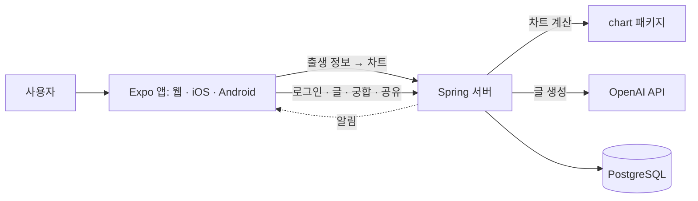

# 앱 아키텍처

> 상태: 활성 · 기준 2026-11-11 · 구조·의존 규칙 결정: docs/decisions/017-dev-session-and-boundaries.md. 코드가 생기면 `docs/codebase-map.md` 가 진입점을 맡는다.

## 구성


## 저장소 구조
- 앱 저장소(이 저장소) — Expo 앱과 기획 문서. Expo 규칙은 `AGENTS.md`.
- 서버 저장소 `byeolmyeong-api`(로컬 `../byeolmyeong-api`) — Spring Boot(Kotlin) 서버. API 계약의 원본은 그 저장소의 `docs/architecture.md` 다.
- 두 저장소는 HTTP API 로만 만난다.

## 앱이 하는 일과 하지 않는 일
- 한다: 입력 받기, 서버가 준 차트·글을 그리기, 로그인 흐름, 공유·알림 연결, 받은 결과를 기기에 보관.
- 하지 않는다: 차트·별자리·하우스·변곡점 구간·궁합 점수 계산, 글 생성, 만 14세 판정. 전부 서버가 한다. 결정: docs/decisions/006-server-side-chart.md

## 디렉터리 구조 (src/)
```
app/                 화면(Expo Router, 파일이 곧 라우트). 화면은 얇게: features 의 훅·부품을 조립만 한다
  index.tsx          출생 정보 입력 (태스크 4 뒤에는 가입 마지막 단계)
  reading.tsx · report.tsx · chart/ · synastry/ · invite/[id].tsx · s/[shareId].tsx · settings.tsx
features/            기능별 로직과 기능 전용 부품
  auth/              세션(개발용 세션 → 나중에 소셜 로그인), 세션 토큰 보관, 로그인 전 가드
  chart/             차트 휠·표·입력 폼 (서버가 준 Chart 만 그린다)
  reading/           요약 해석 요청 상태·문단 부품
  report/            심층 리포트·변곡점 타임라인
  synastry/          궁합·랭킹
  direction/         방향성 제시 부품
  share/             공유 카드(9:16 이미지)·공유 시트
components/          공용 부품(버튼·입력 줄·표·차트 표식·시트·탭…). 기능을 모른다
constants/theme.ts   디자인 값의 단일 출처
content/strings.ts   문구의 단일 출처
lib/api.ts           서버 호출(세션 헤더, 결과 종류)과 계약 타입 · lib/fixtures/ 응답 예시
```
- 기능 폴더 안에서 훅은 `use-<이름>.ts`, 부품은 `<이름>.tsx`, 테스트는 `__tests__/`.
- 화면을 렌더하는 테스트는 `src/__tests__/` 에 둔다. `app/` 안에 두면 라우트가 되고, `features/` 에 두면 `app` 을 import 해 의존 규칙에 걸린다.
- 다른 기능이 가져다 써도 되는 파일은 `eslint.config.js` 의 `SHARED_FEATURE_FILES` 에 적는다(지금: `chart/ChartWheel.tsx`, `auth/use-session.ts`).

## 의존 규칙 (결정 017 — `npx expo lint` 가 실패하면 위반이다)
| 규칙 | 이유 | 강제 |
|---|---|---|
| 공용(`components`·`constants`·`content`·`lib`, 그리고 `app`·`features`·`__tests__` 밖의 모든 `src/` 최상위 폴더)은 `app`·`features` 를 import 하지 않는다 | 공용이 기능을 알면 순환이 생긴다 | `import/no-restricted-paths` |
| `features/<A>` 는 다른 `features/<B>` 를 import 하지 않는다. 예외: `eslint.config.js` 의 `SHARED_FEATURE_FILES`(지금 `chart/ChartWheel.tsx`, `auth/use-session.ts`). `features/` 바로 아래에는 파일을 두지 않는다 | 기능 하나를 고칠 때 다른 기능이 깨지지 않게 | `import/no-restricted-paths` |
| `features` 는 `app` 을 import 하지 않는다 | 화면은 위, 기능은 아래 | `import/no-restricted-paths` |
| 서버 호출은 `lib/` 에서만 한다(`lib/api.ts`). 화면·기능은 `fetch`·`XMLHttpRequest`·`expo/fetch` 를 쓰지 않는다 | 세션 헤더·오류 처리를 한 곳에서 | `no-restricted-globals`·`-properties`·`-imports` |
| 색·글자·간격은 `constants/theme.ts`, 문구는 `content/strings.ts` 에서만 | 디자인·번역이 한 곳에서 바뀐다 | 리뷰 |
| 차트·변곡점·점수 계산을 앱에서 하지 않는다 | 서버가 계산한다(결정 006) | 리뷰 |

## 데이터 흐름
- 차트: 입력 → `POST /charts` → 받은 `Chart` 를 그리고 기기에 보관. 다시 열 때는 보관본을 쓴다.
- 세션(지금): 개발 빌드(`EXPO_PUBLIC_DEV_SESSION=1`)는 앱이 켜질 때 `POST /auth/dev` 로 세션 토큰을 받는다(결정 017, 서버 결정 005).
- 세션(브랜딩 뒤): 구글·애플·카카오에서 받은 토큰을 `POST /auth/login` 에 보내 세션 토큰을 받는다. 같은 `features/auth` 자리에서 바꾼다.
- 세션 토큰은 기기 보안 저장소에만 두고, 요청마다 `Authorization: Bearer <token>` 헤더로 보낸다.
- 글: 세션이 있어야 요청한다. 요약 해석은 바로 받고, 리포트는 202 를 받은 뒤 상태를 확인하거나 알림으로 완성을 안다.
- 서버가 준비되기 전에는 `lib/fixtures/` 의 응답 예시로 화면을 만든다.

## 비즈니스 룰 (앱이 지키는 것)
- 스플래시 직후 로그인을 받는다. 로그인 없이 열리는 화면은 공유 페이지뿐이다. 결정: docs/decisions/009-signup-first-kakao-age14.md (005 를 대체). 지금은 개발용 세션으로 대신한다(결정 017).
- 시각 "모름"이면 하우스·상승궁을 보여 주지 않는다.
- 초대로 연결된 궁합에서는 상대의 차트를 그리지 않는다. 서버가 상대의 위치를 내려주지 않는다.
- 출생 정보와 세션 토큰을 로그·분석 이벤트에 남기지 않는다.
- 알림 허용은 리포트 요청이나 초대 링크 생성 직후에만 묻는다.

## 관련
- 기능 명세: docs/release-1.0.0.md · 제품 방향: docs/product.md · 결정: docs/decisions/
