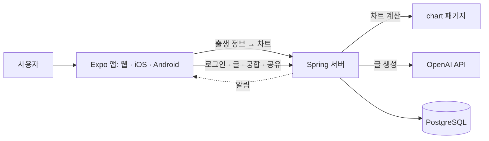

# 앱 아키텍처

> 상태: 활성 · 기준 2026-11-11 · 구조·의존 규칙 결정: docs/decisions/017-dev-session-and-boundaries.md. 코드가 생기면 `docs/codebase-map.md` 가 진입점을 맡는다.

## 구성


## 저장소 구조
- 앱 저장소(이 저장소) — Expo 앱과 기획 문서. Expo 규칙은 `AGENTS.md`.
- 서버 저장소 `byeolmyeong-api`(로컬 `../byeolmyeong-api`) — Spring Boot(Kotlin) 서버. API 계약의 원본은 그 저장소의 `docs/architecture.md` 다.
- 두 저장소는 HTTP API 로만 만난다.

## 앱이 하는 일과 하지 않는 일
- 한다: 입력 받기, 서버가 준 차트·글을 그리기, 로그인 흐름, 공유·알림 연결, 받은 결과를 기기에 보관.
- 하지 않는다: 차트·별자리·하우스·변곡점 구간·궁합 점수 계산, 글 생성, 만 14세 판정. 전부 서버가 한다. 결정: docs/decisions/006-server-side-chart.md

## 디렉터리 구조 (src/)
```
app/                 화면(Expo Router, 파일이 곧 라우트). 화면은 얇게: features 의 훅·부품을 조립만 한다
  _layout.tsx        루트: 글꼴 · 강제 업데이트 문 · 이용 정지 문(features/auth/suspension-gate.ts 의 `useSuspensionGate` — 로그인 직후 답이 올 때까지 가림 · 스플래시도 그동안 둠, 결정 065 의 5) · 로그인 전 가드(features/auth/guard.ts — 로그인 전 · 소개 안 봄 /intro, 로그인 전 /login, 가입 중 /signup/terms(가입 단계와 이용약관 · 개인정보 수집 · 이용 동의 · 처리방침 · 마케팅 수신 동의 약관은 열림), /s · /auth 는 열림, 결정 034 · 042) · 스플래시(웹은 components/splash-view.tsx 를 그리고 앱은 네이티브 스플래시를 둔다 — 글꼴 · 세션 · 소개 기록 확인이 끝나 보낼 곳에 간 뒤 걷는다, 웹은 최소 0.8초, 결정 067) · 약관 글 네 화면은 아래에서 올라오는 창(Stack.Screen 옵션 components/slide-up.ts, 결정 067) · 결정 068: 가입 중이면 하던 단계로 보내고, 스플래시는 로그인한 홈의 첫 데이터(features/home/home-ready.ts) 둔다 · 공유 페이지엔 없다 · 웹이 서버에 닿지 못해 세션이 offline 이면 30초마다 다시 확인 · 덮인 동안 화면 쌓기는 inert · 오류 경계(ErrorBoundary)가 웹 화면 조각 실패를 받아 한 번 새로 고침(features/update/chunk-reload.tsx) · 가입 닉네임 · 출생 정보 단계는 웹에서 오른쪽에서 밀려 들어온다
  +native-intent.tsx 시스템이 연 주소 거르기(앱만): 카카오 로그인 돌아오기 주소(`kakao…://oauth…`)와 첫 경로 조각이 `oauth` 인 주소는 화면을 옮기지 않는다(null — "Unmatched Route" 안전망, 빌드 8). 그 밖의 주소는 그대로
  index.tsx          홈 v2(머리 로고 · 알림 종 · 별명 카드 · 오늘의 하늘 · 지금 나의 시기 · 작은 실천 · 알림 받기 권유 시트 · 아래 탭 넷, 결정 047 · 051 · 055 · 066. 출생 정보가 없으면 입력 · 서버의 것으로 되살리기 — 되살리는 동안은 뼈대, 결정 071)
  intro.tsx · login.tsx · auth/kakao.tsx · auth/google.tsx   소개 2장(이 기기에서 처음 한 번, 결정 055) · 로그인(공급자 버튼 — 서버를 기다리는 동안 이 화면에 머물고 누른 버튼에 돌기, 결정 067. 웹 구글에서 실패하고 돌아오면 `?failed=1` 로 실패 안내, 결정 070) · 카카오 웹 로그인에서 돌아오는 화면(스플래시 모양으로 기다린다, 결정 034 · 042 · 067) · 구글 웹 로그인에서 돌아오는 화면(주소 조각의 ID 토큰을 state · nonce 로 확인하고 조각을 지운다, 결정 070)
  signup/            단계식 가입(결정 042): terms.tsx(약관 동의) → nickname.tsx(닉네임 · 프로필) → birth.tsx(출생 정보, 여기서 POST /auth/signup 한 번)
  me.tsx(나 탭: 받기 전 내 별명 + 자세한 풀이 카드 · 받은 뒤 별명 카드 + 칩 다섯, 결정 048 · 050) · reading.tsx(내 별명: 요약 해석 전체 페이지 · 별명 공개) · today.tsx(오늘의 하늘 — 그날의 하늘과 같은 틀, 결정 051) · notifications.tsx(알림함, 결정 052 · 058) · timing/(index 시기 탭: 칩 셋 이번 달 · 올해 · 인생 `?tab=` · 받기 전 잠긴 칩 · 받은 뒤 지금 나의 시기, 결정 049 · period 시기 자세히 `?id=` · day 그날의 하늘 `?date=`) · chart/(index 내 하늘 지도 — `?selected=` 로 고른 별을 받는다 · detail 차트 자세히 표) · synastry/(1.0.0 에서는 _layout.tsx 가 모든 주소를 홈으로 보낸다, 결정 055) · s/[shareId].tsx · suspended.tsx(이용이 정지된 계정, 보드 22 — 정지 문만 이리로 보낸다) · my/(마이 v2, 결정 056 · 084: index 별명 카드(누르면 내 정보) · 제목 없는 목록 카드 둘 · account 내 정보(프로필 · 닉네임 · 출생 정보 한 줄과 "수정 ›" → birth · 연결된 계정 · 로그아웃 가운데 창 · 맨 아래 계정 삭제) · nickname 닉네임 바꾸기(치기를 멈추면 `GET /account/nickname-check` 로 초록 · 빨강, 서버 결정 051) · notifications 알림(푸시 · 오늘의 하늘과 받는 시간 · 이벤트 · 혜택) · birth 출생 정보 바꾸기(→ 별명 짓는 중) · delete 계정 삭제 → 지웠어요 · music 음악 스위치 셋(1.0.0 에서는 마이로 보냄, 결정 069) · inquiries/ 문의 내역 · new 새 문의(→ 보냈어요) · [id] 답변 보기, 결정 058) · settings/(자주 묻는 질문 · 옛 문의하기 주소(→ /my/inquiries/new) · 처리방침 · 약관 · 마케팅 수신 동의 약관 · 개인정보 수집 · 이용 동의(privacy-consent — 약관 단계의 보기 · 동의하기, 결정 045) — 목록 화면은 없다. 약관 글은 결정 043)
features/            기능별 로직과 기능 전용 부품
  auth/              세션(session-store · use-session 의 useAuth — 소셜 로그인 · 가입 · 닉네임 확인 · 가입 그만두기 · 로그아웃, 개발용 세션. 상태는 확인 중 · 로그인 전 · 가입 중 · 로그인 · offline(웹이 시작할 때 서버에 닿지 못함, recheck 로 다시 확인 — 결정 068)), 가입 이어 하기(signup-resume.ts — 가입권 · 공급자 · 초안 · 단계 · 받은 시각을 앱은 보안 저장소, 웹은 sessionStorage 에 30분만, 출생 정보는 없음, 결정 068), 공급자 버튼(providers/ — `google`·`apple`·`kakao` 의 기본(앱) · `.ios` · `.web` 파일, 같은 이름의 버튼, 모양은 social-button.tsx 하나 — 웹 카카오 · 구글은 인가 주소로 이동하고 `/auth/*` 로 돌아온다(주소 만들기 · 돌아온 값 읽기는 web-redirect.ts), 결정 034 · 070), 최근 로그인(last-provider.ts — 마지막에 로그인한 공급자 이름만 AsyncStorage `byeolmyeong-device.lastProvider.v1`, 로그아웃 · 탈퇴가 지우지 않는다, 결정 044), 세션 토큰 보관, 로그인 전 가드(guard.ts), 가입 단계 뼈대(signup-step.tsx) · 초안(signup-draft.ts — 메모리, 가입권이 살아 있는 동안 signup-resume 에도) · 닉네임 규칙(nickname-rule.ts) · 프로필 고르기 시트(avatar-sheet.tsx), 로그아웃(sign-out.ts — 기기 저장도 비움), 새 로그인(로그인 · 가입 완료 — 로그인 상태가 되기 전)과 401 로 로그인 전이 될 때도 기기 저장을 비움(session-store 의 `clearDeviceData` — 세션 만료 뒤 다른 계정이 앞사람의 출생 정보 · 풀이를 보지 않게, 홈이 서버에서 되살린다), 이용 정지(suspension.ts — 메모리의 정지 표시와 보낼 곳 규칙 · suspension-gate.tsx — 루트에 두는 문, 결정 065 의 5), 계정 삭제(delete-account.ts — 서버가 지운 뒤 기기 저장 비움. 세션은 "계정을 지웠어요" 의 확인에서 화면이 비운다 — 먼저 비우면 루트 가드가 그 화면을 로그인으로 바꾼다)
  home/              홈의 별명 카드(nickname-card.tsx) · 계정의 닉네임 · 프로필(use-account.ts, `GET /account` — 마이와 같은 getMyAccount) · 홈의 첫 데이터가 끝났는지(home-ready.ts — 루트가 그때까지 스플래시를 둔다, 결정 068. 출생 정보 · 차트에 더해 홈 카드의 첫 상태 — 시기 칸의 보관본 · 상태 응답, 오늘의 하늘의 보관본 · 글 · 1초 넘으면 쓰는 중 — 까지 기다려 뼈대 없이 바로 그린다, 소유자 2026-11-21) · 받은 지 며칠(days-since.ts, 한국 날짜) · 아래 탭 넷(main-tabs.tsx — 나 /me · 시기 /timing. 탭 안에서 들어간 화면(nested)에서 지금 탭을 다시 누르면 그 탭의 첫 화면으로)
  audio/             음악 세 곡(결정 062 — **1.0.0 에서는 꺼 둔다**, 결정 069: 루트 · 스플래시에 걸지 않고 `MUSIC_IN_APP` 이 false 라 `/my/music` 은 마이로 보낸다. 다시 켤 일은 069 의 4): 곡 파일 · 음량(tracks.ts — 파일은 `assets/audio/`, 바꿔 끼우는 법은 그 README) · 앱에 하나인 음악 줄(soundtrack.ts — 배경이 기본, 화면이 청한 곡, 꺼 둔 곡은 틀지 않음, 바뀔 때 줄였다 키움, 무음 모드 존중 · 섞임 · 뒤로 가면 멈추고 돌아오면 이어서(iOS 가 스스로 다시 트는 플레이어는 멈춤) · 웹은 첫 누름(pointerup · touchend · keydown) 뒤 배경만) · 화면 훅(use-soundtrack.ts — 공유 파일: `useSoundtrack('waiting' | 'opening')` · 루트의 `useSoundtrackRoot`) · 설정(music-settings.ts — AsyncStorage `byeolmyeong-device.music.v1`, 로그아웃 · 탈퇴가 지우지 않는다) · 스위치 셋 화면(music-screen.tsx — `/my/music` 이 열릴 때만 보인다)
  my/                마이 v2(결정 056): 마이의 별명 카드(my-card.tsx) · 계정을 화면이 보일 때마다 받기(use-my-account.ts, `GET /account` — 기기에 두지 않음) · 연결된 계정의 가린 이메일(mask-email.ts) · 공급자 표시(provider-badge.tsx) · 알림 설정(notification-settings.ts — 계정에서 알림 칸만 꺼냄 · 마이 첫 줄의 받는 시간, use-notification-settings.ts — 누르면 바로 바꾸고 `PATCH /account` 에 그 칸만, 마지막 요청의 답만 쓰고 못 하면 되돌림)
  onboarding/        소개 2장의 그림(intro-art.tsx)과 이 기기에서 봤는지(intro-seen.ts — AsyncStorage `byeolmyeong-device.introSeen.v1`, 로그아웃 · 탈퇴가 지우지 않는다, 결정 042)
  chart/             내 하늘 지도(휠 · "별마다 있던 자리" · 별 시트, 용어는 `strings.glossary`)·겹친 휠(궁합)·표·입력 폼과 출생 정보 세 칸(BirthFields) · 태어난 곳 시트(place-sheet.tsx — 검색 · 시 · 도 칩 → 시 · 군 · 구, 결정 042) (서버가 준 값만 그린다). 기기에 출생 정보가 없을 때 서버의 것으로 되살리기(use-birth-restore.ts, 결정 029)
  me/                나 탭 풀이(결정 048 · 050): 요청 · 5초 확인 · 기기 보관(use-me-report.ts — 공용 훅 lib/detail-report 에 `POST`/`GET /me-report` · AsyncStorage `byeolmyeong.meReport.v1` · 검사 함수를 넘김) · 영역 칸(area-view.tsx — 한눈에 보기 · 작은 실천 · 가까워지는 모습 · 일 방식 막대 · 마음이 흔들릴 때 · 번호 문단) · 쓰인 별의 말(me-stars.ts) · 별명 카드 · 칩 · 자세한 풀이 카드 · 뼈대(me-parts.tsx) · 영역 그림(area-art.tsx)
  reason/            "이렇게 풀이한 이유"(결정 054): 근거 구조 → 한 문장(reason-sentence.ts — 정해진 틀 + 용어 사전, 조사는 받침으로, 시각 모름이면 하우스 부분을 뺀다, 모르는 kind 는 null) · 펼침의 용어 줄과 빛낼 별 · 칸(reason-terms.ts) · 접힌 줄과 펼침(reason-line.tsx — 작은 지도는 chart/ChartWheel.tsx 의 MiniWheel, 펼침의 움직임은 reason-reveal.tsx(앱, Reanimated) · reason-reveal.web.tsx(웹, RN Animated — 웹 번들에서 Reanimated 를 뺀다)가 reason-reveal-shape.ts 의 같은 모양으로). 나 탭 · 시기 · 오늘의 하늘이 함께 쓴다(SHARED_FEATURE_FILES)
  reading/           요약 해석 요청 상태 · 내 별명의 글(reading-view.tsx — 문단마다 ReasonLine, 내 별명과 나 탭 받기 전이 함께 쓴다) · 별명 공개(reveal-view.tsx — 가입 직후 한 번, 값은 reading.tsx 가 풀이 · 차트 · 가입이 받은 닉네임(메모리)으로 채운다, 결정 044). 별명 짓는 중(MakingView)은 공용 components/making-view.tsx(쓰는 중 화면들이 제목 · 문구를 넘긴다 — 머리(뒤로 · 제목)는 넘기지 않는다, 아래 탭이 있던 곳은 탭만. 글을 쓰는 동기 요청은 3분(lib/with-timeout `GENERATION_MAX_WAIT_MS`)이 넘으면 머리가 있는 못 썼을 때로, 소유자 빌드 13)
  timing/            시기 탭 v2(결정 049 · 050): 날짜 글자 도구(dates.ts — 잘라 적기 · 글자 비교 · 달력 칸 배치 · 띠와 "지금" 점의 자리, 점성 계산 없음) · 시기 풀이 요청 · 5초 확인 · 기기 보관(use-timing-report.ts — 공용 훅 lib/detail-report 에 경로 쌍 · 보관 키 · 검사 함수를 넘김, `POST`/`GET /timing-report`, AsyncStorage `byeolmyeong.timingReport.v1` — 다 쓴 풀이와 함께 받기 전 · 쓰는 중 상태도 출생 정보별로 기억(rememberStatus), 홈의 시기 칸은 `poll: false` 로 상태만 한 번) · 이번 달(use-month.ts — `GET /timing/month`, 첫 달 ±1, 처음 받은 이번 달 하나만 `byeolmyeong.monthSky.v1` 에 두고 다음에 열면 바로 · 뒤에서 새로, 결정 074. 이번 달을 그리면 앞뒤 달을 뒤에서 한 번씩 받아 이번 실행 메모리에 두고, 받는 중에 넘기면 그릴 달(drawn)은 이전 달 그대로 — 처음 넘겨도 뼈대 없이. 달력 칸은 자리로 이어 써 격자가 다시 붙지 않는다) · 그날의 하늘(use-day-sky.ts — `POST /day-sky`, 보관 없음, 한 번의 요청은 3분까지) · 시각 "모름" 이중 안전(time-known.ts — shownTiming · shownMonth: 받았더라도 돈 · 운명적 만남 구간과 상승점 · 중천 · 하우스가 근거인 날을 그리지 않는다, 시기의 모든 화면이 거친다) · 화면 조각(timing-parts.tsx — 지금 나의 시기 카드 · 칩 셋 · 딱지 · 작은 실천 · 구간 줄 · 자세한 풀이 카드 · 잠긴 자리(자물쇠 카드만) · 본뜬 칸 표시 SkBlock — 글 줄은 공용 SkeletonText, 화면마다 SkeletonGroup) · 이번 달(month-view.tsx) · 올해(year-view.tsx — 대표 구간은 서버의 mainId) · 인생(life-view.tsx) · 시기 자세히(period-view.tsx) · 그날의 하늘(day-view.tsx) · 홈의 시기 칸(home-timing-card.tsx — 홈 화면이 넣는다). 화면마다 그 배치를 본뜬 뼈대를 같은 파일에 둔다(결정 071) · 오늘의 하늘(use-today-sky.ts — 날짜 없이 POST /day-sky, 그날 것을 기기에 `byeolmyeong.daySky.v1` · 홈 카드와 함께 한 번만 묻기, home-today-card.tsx — 홈 카드 · 뼈대 · 쓰는 중 카드, 결정 051)
  notifications/     알림함(결정 052 · 058): 목록 받기(use-notifications.ts — 화면이 보일 때마다 `GET /notifications`, 누른 줄은 바로 읽음으로 보이고 `POST /notifications/{id}/read`) · 줄의 규칙(notification-rows.ts — 보일 줄 · 누르면 갈 곳(휴대폰 푸시의 표와 같다) · 한국 날짜로 오늘 · 최근 7일 · 최근 30일 · 때 · 문구 · 홈 종의 점) · 줄 · 비었을 때 · 뼈대(notification-list.tsx) · 홈 머리의 종(home-bell.tsx)
  synastry/          (1.1.0 대기 — 1.0.0 에서는 어디서도 열지 않는다, 결정 055 · 새 설계 063) 궁합(직접 입력)·랭킹·궁합 리포트의 상태와 부품. 방금 계산한 궁합의 메모리 보관(fresh-synastry.ts). 궁합 지우기(delete-synastry.ts · 확인 시트 synastry-delete-sheet.tsx)
  direction/         (1.1.0 대기, 결정 055) 방향성 제시(궁합)의 요청 상태·글 부품(결정 026). 이성 · 미래는 없앴다(결정 048 · 049)
  push/              휴대폰 푸시(결정 057 · 066, 계획 A8-1 — 공유 파일 push.ts · push-data.ts, 웹은 같은 이름의 빈 구현 push.web.ts 라 expo-notifications 가 웹 묶음에 없다): 권한 읽기 · 묻기(안드로이드는 채널 먼저) · 이 기기 등록(`POST /push/devices`, 토큰은 AsyncStorage `byeolmyeong-device.push-token.v1` — 로그아웃 정리가 지우지 않는 기기 값) · 로그아웃 때 해제(sign-out.ts 가 세션 지우기 전에 `DELETE /push/devices/{토큰}`) · 루트의 `usePushDeviceSync`(로그인하면 다시 등록, 토큰이 바뀌면 다시) · `usePushTapRouting`(누르면 화면들 · 로그인 · 정지 확인 뒤 그 종류의 화면으로, 쓰는 중 배너 없음) · `onPushReceived`(쓰는 중 온 푸시 — 홈 종 · 알림함) · data 읽기와 갈 곳(push-data.ts 의 `parsePushData` · `pushTarget` — 앱 밖 주소는 버림). 알림 받기 권유 시트(push-ask-sheet.tsx — 보드 11-10, 처음 홈에서 한 번 · 휴대폰 권한을 아직 묻지 않았을 때만, 기기 값 `byeolmyeong-device.push-ask.v1`). 웹은 모두 아무것도 하지 않는다
  support/           자주 묻는 질문을 받아 오는 상태(use-faqs.ts, 메모리에만 5분) · 목록, 문의의 입력 확인 · 날짜(inquiry.ts) · 보내는 상태(use-inquiry.ts) · 내역 · 한 건을 보일 때마다 받기(use-inquiries.ts) · 종류 칩(결정 028 · 058)
  update/            강제 업데이트(결정 027 · 059)와 점검 안내(결정 030 · 060): 버전 비교 · 권유 판정(version.ts) · 셋의 판정(update-store.ts) · 루트를 감싸는 문과 바쁨 등록(update-gate.tsx) · 막는 화면(update-required.tsx · maintenance-notice.tsx) · 권유 창(update-suggest.tsx) · 웹 화면 조각을 못 불러오면 한 번 새로 고침(chunk-reload.tsx — 루트의 ErrorBoundary)
  share/             공유 v2(결정 053): 공유 카드(9:16, 서버가 준 card 만으로 그린다 — v2 넷은 시안 카드, 옛 넷은 "별이와 함께" · 기다리는 동안의 카드 모양 뼈대, share-card.tsx · 달 · 계단 그림 share-art.tsx — 해 별자리는 chart/ChartWheel.tsx 의 SignArt, 영역은 me/area-art.tsx)·공유 아이콘과 시트(share-entry.tsx — 제목 없음, 결과는 Toast)·이미지 저장 · 스토리(앱 share-actions.ts — 사진 앱 · 인스타그램 스토리 → 없으면 기기 공유 창, 웹 share-actions.web.ts — PNG 내려받기)·인스타그램 스토리 열기(story.ts — react-native-share, 웹 story.web.ts 는 없음)·공유 페이지의 카드 받기
components/          공용 부품(버튼·입력 줄·표·시트·가운데 창 Dialog·짧은 알림 Toast·뼈대 Skeleton·탭·제목 없는 목록 카드 ListCard(화살표 · 값 · 스위치 줄, 이름 아래 설명), 시각 드럼 TimeWheel · 받는 시간 시트 TimeSheet(시안 8-1 — 출생 시각 · 받는 시간이 함께 씀, 분 간격)…, 별명 카드(홈 · 마이)의 해 별자리 장식 CardConstellation(화면이 서버 차트의 SUN 으로 chart/constellations.ts 의 모양을 골라 넘긴다), 상태: 실패 화면 StateScreen · 연결 끊김 띠 OfflineBanner, 브랜드 그림: 로고 · 별이 · 빛나는 모양 · 스플래시 SplashView, 아래 · 오른쪽에서 들어오는 화면 slide-up.ts — 약관 글 TextPage · 가입 단계 SignupStep 이 쓴다, 웹 inert use-inert.ts). 기능을 모른다
constants/theme.ts   디자인 값의 단일 출처
content/strings.ts   문구의 단일 출처
content/legal.ts     약관 · 처리방침 · 마케팅 수신 동의 약관의 글. 랜딩 app/data/legal.ts 와 같은 사본(결정 043)
lib/api.ts           서버 호출(세션 헤더 · 버전 헤더, 결과 종류)과 계약 타입 · lib/fixtures/ 응답 예시 · 내 계정은 getMyAccount 하나(홈 · 마이)
lib/with-timeout.ts  한 번의 요청을 기다리는 한도(10초 — 결정 065 의 2, 나 탭 풀이 · 시기 풀이 · 이번 달)
lib/storage-generation.ts 기기 보관의 세대 표식(요청을 시작할 때 읽고 같을 때만 둔다 — 로그아웃 뒤 늦게 온 답이 다시 쓰지 않게. 공유 카드 기억 · 오늘의 하늘 · 이번 달)
lib/detail-report.ts 자세한 풀이 공용 훅 useDetailReport(요청 · 5초 확인 · 3분 한도 · 보관본 먼저 · 404 저장 뒤 한 번 더 · 402 막힘 — 풀이마다 경로 쌍 · 보관 키 · 검사 함수 · poll · rememberStatus(받기 전 · 쓰는 중도 기억해 다시 열 때 곧바로 — 시기만)를 받는다). 나 탭 풀이 · 시기 풀이가 쓴다
lib/app-client.ts    이 앱의 플랫폼과 버전(expo 설정의 version). 웹은 null
```
- 기능 폴더 안에서 훅은 `use-<이름>.ts`, 부품은 `<이름>.tsx`, 테스트는 `__tests__/`.
- 화면을 렌더하는 테스트는 `src/__tests__/` 에 둔다. `app/` 안에 두면 라우트가 되고, `features/` 에 두면 `app` 을 import 해 의존 규칙에 걸린다.
- 다른 기능이 가져다 써도 되는 파일은 `eslint.config.js` 의 `SHARED_FEATURE_FILES` 에 적는다(지금: `chart/ChartWheel.tsx`, `auth/use-session.ts`, `audio/use-soundtrack.ts`, `reason/reason-sentence.ts`, `reason/reason-line.tsx`, `reason/reason-reveal.tsx`(이유 상자의 펼침 움직임 — 앱은 Reanimated, 웹은 같은 이름의 `.web.tsx` 가 대신한다. 자주 묻는 질문 support 도 쓴다), `push/push.ts` · `push/push-data.ts`(휴대폰 푸시 — 로그아웃 auth/sign-out · 알림함 notifications · 오늘의 하늘 timing 이 쓴다), `me/area-art.tsx` — 나 탭 영역 그림을 공유 카드가 쓴다, `update/update-gate.tsx` — 업데이트 권유 상태를 홈의 알림 받기 권유가 본다).

## 의존 규칙 (결정 017 — `npx expo lint` 가 실패하면 위반이다)
| 규칙 | 이유 | 강제 |
|---|---|---|
| 공용(`components`·`constants`·`content`·`lib`, 그리고 `app`·`features`·`__tests__` 밖의 모든 `src/` 최상위 폴더)은 `app`·`features` 를 import 하지 않는다 | 공용이 기능을 알면 순환이 생긴다 | `import/no-restricted-paths` |
| `features/<A>` 는 다른 `features/<B>` 를 import 하지 않는다. 예외: `eslint.config.js` 의 `SHARED_FEATURE_FILES`(지금 `chart/ChartWheel.tsx`, `auth/use-session.ts`, `audio/use-soundtrack.ts`, `reason/reason-sentence.ts`, `reason/reason-line.tsx`, `reason/reason-reveal.tsx`, `me/area-art.tsx`, `push/push.ts`, `push/push-data.ts`, `update/update-gate.tsx`). `features/` 바로 아래에는 파일을 두지 않는다 | 기능 하나를 고칠 때 다른 기능이 깨지지 않게 | `import/no-restricted-paths` |
| `features` 는 `app` 을 import 하지 않는다 | 화면은 위, 기능은 아래 | `import/no-restricted-paths` |
| 서버 호출은 `lib/` 에서만 한다(`lib/api.ts`). 화면·기능은 `fetch`·`XMLHttpRequest`·`expo/fetch` 를 쓰지 않는다 | 세션 헤더·오류 처리를 한 곳에서 | `no-restricted-globals`·`-properties`·`-imports` |
| 색·글자·간격은 `constants/theme.ts`, 문구는 `content/strings.ts` 에서만 | 디자인·번역이 한 곳에서 바뀐다 | 리뷰 |
| 차트·변곡점·점수 계산을 앱에서 하지 않는다 | 서버가 계산한다(결정 006) | 리뷰 |

## 데이터 흐름
- 차트: 입력 → `POST /charts` → 받은 `Chart` 를 그리고 기기에 보관. 다시 열 때는 보관본을 쓴다.
- 세션(개발용): 개발 빌드(`EXPO_PUBLIC_DEV_SESSION=1`)는 앱이 켜질 때 `POST /auth/dev` 로 세션을 받는다(결정 017, 서버 결정 005). Vercel 배포(스테이징 · 운영)에는 켜지 않는다(결정 037). 공유 페이지(`/s/…`)에서는 받지 않는다(결정 025).
- 세션(소셜 로그인, 결정 034 · 서버 결정 021): 공급자에서 받은 자격 증명(ID 토큰, 카카오 웹은 인가 코드)을 `POST /auth/login` 에 보낸다. 계정이 있으면 세션, 처음 온 사람은 가입권을 받아 단계식 가입(`/signup/terms` → `/signup/nickname` → `/signup/birth`, 결정 042)을 밟는다. 앞 단계 값(약관 버전 · 동의 · 닉네임 · 프로필)은 메모리 초안에만 두고, 닉네임 중복은 "다음" 에서 `POST /auth/nickname-check` 한 번, 마지막에 출생 정보와 함께 `POST /auth/signup` 한 번 — 서버가 만 14세를 판정한다(미만 403 `UNDER_AGE`, 가입권을 지운다). 로그아웃은 `DELETE /auth/session`. 웹이 켜질 때는 `GET /auth/session` 으로 쿠키 세션이 살아 있는지 본다. 앱의 카카오 로그인은 카카오톡에서 돌아오는 주소(`kakao{앱 키}://oauth?code=…`)를 카카오 SDK 가 받는다 — 안드로이드는 SDK 의 `AuthCodeHandlerActivity`(카카오 플러그인이 넣는다), iOS 는 SDK 58 이 주소 열기를 장면(SceneDelegate)으로 받아 카카오 플러그인이 AppDelegate 에 넣을 자리가 없으므로 `plugins/with-kakao-scene-delegate.js` 가 SceneDelegate 의 `scene(_:openURLContexts:)` 에 넣는다(카카오 키가 있는 빌드만, 운영 · 테스트 같음). 인가 코드 · 토큰은 로그에 남기지 않는다.
- 세션 토큰: 앱(iOS·Android)은 기기 보안 저장소에만 두고 요청마다 `Authorization: Bearer <token>` 헤더로 보낸다. 웹은 서버의 httpOnly 쿠키 `bm_session` 에 맡기고 모든 요청에 `credentials: 'include'` 를 붙인다(토큰을 받지도 두지도 않는다).
- 출생 정보: 입력 화면이 차트를 받은 뒤 세션이 있으면 `PUT /profile` 로 서버에도 저장한다. 요약 해석은 서버가 이 값으로 쓴다. 시각이 "모름"(`time: null`)이어도 태어난 곳 칸은 보이고(없어도 된다) `placeId: null` 을 보낸다(서버는 시각이 없으면 곳을 읽지 않는다). 골랐으면 곳은 기기에만 남는다(입력 칸을 채울 때 쓴다, 결정 042 — 020 의 "곳을 묻지 않는다" 대체).
- 출생 정보 되살리기(결정 029): 홈(`/`)이 기기 저장소를 읽었는데 출생 정보가 없고 세션 토큰이 있으면 `GET /profile` 을 한 번 부른다(`features/chart/use-birth-restore.ts`). 200 이면 그 입력으로 `POST /charts` 를 받고, 시각을 알면 `GET /places` 에서 `placeId` 의 이름을 찾아(못 찾으면 이름을 비워 두고 식별자만) 입력 화면과 같은 `saveBirth` 로 기기에 둔 뒤 홈을 그린다. `PUT /profile` 은 다시 하지 않는다. 확인하는 동안(세션을 기다릴 때 포함)에는 0.3초가 넘으면 되살린 뒤의 홈을 본뜬 뼈대만 보인다(결정 071 — 처음 열 때는 스플래시가 가린다). 404 `NO_PROFILE` · 그 밖의 실패 · 차트를 받지 못함이면 입력 화면이다. 기기에 출생 정보가 있거나 세션이 없으면 부르지 않고, 가짜 서버는 404 로 답한다. 공유 페이지에서는 하지 않는다(홈이 아니다). 글(풀이 · 리포트 · 방향성)은 따로 되살리지 않는다 — 그 화면들이 서버에 묻고 서버가 저장된 글을 준다.
- 글: 세션이 있어야 요청한다. 요약 해석(`POST /readings`, 본문 없음)은 바로 받아 출생 정보별로 기기에 보관하고, 다시 열 때는 보관본을 쓴다. 401 이면 세션을 한 번 다시 받는다. 자세한 풀이(나 탭 풀이 · 시기 풀이)는 202 를 받은 뒤 상태를 확인한다. 다 쓴 풀이도 기기에 보관해 먼저 보여 주고 뒤에서 새로 받는다 — 시기 풀이의 "지금"(`current`) · 대표 구간(`current.mainId`)은 서버가 부를 때마다 그날로 붙이므로 새로 받으면 오늘 것이 된다(결정 049 의 9 · 065 의 2). 시기 탭은 이번 달(`GET /timing/month`, 서버가 요청 때 계산 — 앱은 이번 달 하나만 보관, 결정 074) · 올해 · 인생 · 시기 자세히 · 그날의 하늘(`POST /day-sky`, 서버가 저장 · 앱은 보관 없음)이다(결정 049). 오늘의 하늘(`/today` · 홈 카드)은 같은 경로를 날짜 없이 부르고(서버의 한국 날짜의 오늘), 받은 것을 그날 동안 기기에 둔다(`byeolmyeong.daySky.v1`, `features/timing/use-today-sky.ts` — 오늘 것이면 먼저 그리고 뒤에서 한 번 새로 받으며, 날이 바뀌면 화면이 보일 때 · 앱으로 돌아올 때 다시 부른다. 못 썼으면 다시 보일 때 기기를 다시 읽고(다른 화면이 받아 둔 것), 오늘의 하늘 푸시가 오면 오늘 것이 아닐 때만 새로 묻는다, 결정 051). 알림함(`GET /notifications`)은 화면이 보일 때마다 다시 묻고(홈의 종 · `/notifications`), 쓰는 중에 온 푸시에는 보이는 화면만 다시 묻는다(오늘의 하늘 푸시는 알림 줄이 없어 묻지 않는다), 받은 시각을 한국 시간대로 읽어 오늘 · 최근 7일 · 최근 30일로 묶기만 한다(`features/notifications/notification-rows.ts` — 누르면 갈 곳은 휴대폰 푸시의 표와 같다). 앱은 서버가 준 날짜 글자를 비교해 거르고 달력 칸에 놓기만 한다(`features/timing/dates.ts`): 올해 띠는 그해에 걸친 구간(글자 비교)을 달 단위로 놓고, 다가오는 시기는 오늘(`current.date`) 뒤 1년 안에 시작하는 구간 셋. 해 · 만 나이 · 대표 구간은 서버가 준 값만 적고, 앱이 셈한 "몇 년 뒤" 같은 숫자는 없다.
- 들어가면 바로(결정 075): 뼈대는 "내용이 있는데 아직 안 온" 때만. 자세한 풀이(시기 · 나 탭)는 다 쓴 풀이와 받기 전 · 쓰는 중 기억을 따로 두고(`lib/detail-report.ts`), 그날의 하늘 · 오늘의 하늘은 날짜별 "만든 적 있음"(`features/timing/day-sky-made.ts`, `byeolmyeong.daySkyMade.v1`)을 둔다 — 만든 적 없으면 곧바로 받기 · 만드는 중. 홈은 앱을 켤 때 이번 달(`prefetchMonth`) · 나 탭 풀이 상태(`prefetchMeReport`)를 받아 두고, 시기 칸은 쓰는 중에도 "만들고 있어요" 카드(5초 확인 없이 완성 푸시 · 다시 보일 때 · 앱으로 돌아올 때 다시 묻는다).
- 계정 삭제: 마이 › 계정 › 계정 삭제(`/my/delete`, 결정 056) — 확인 체크 → `DELETE /account`(204) → 성공했을 때만 기기 저장소에서 이 앱의 키(`byeolmyeong.` 으로 시작하는 것 전부)를 지우고 "계정을 지웠어요" 를 보인 뒤, 확인(또는 뒤로 가기 · 지우는 중 화면을 떠났으면 끝나는 즉시)에서 보안 저장소의 세션 토큰을 지우고 로그인 화면(`/login`, 결정 034)으로 간다. 지우는 동안에는 뒤로 갈 수 없다. 로그아웃은 마이 › 계정의 가운데 창에서 하고 같은 곳으로 간다. 실패하면 기기의 것은 건드리지 않는다. 기능이 기기에 새로 두는 키는 `byeolmyeong.<이름>.v<판>` 으로 짓는다(그래야 삭제 때 함께 지워진다). 예외: 사람이 아니라 기기에 붙는 값(소개를 봤는지 — 결정 042, 마지막에 로그인한 공급자 이름 `byeolmyeong-device.lastProvider.v1` — 결정 044)은 일부러 `byeolmyeong-device.` 로 지어 로그아웃 · 탈퇴 뒤에도 남긴다.
- 나 탭 풀이(결정 048 · 050): `/me` 가 기기에 받아 둔 풀이(`byeolmyeong.meReport.v1`, 출생 정보별)를 먼저 보이고 뒤에서 `GET /me-report` 로 새로 묻는다. 없으면 처음 `GET` 이 0.3초를 넘으면 뼈대. "자세한 풀이 받기" 를 누를 때만 `POST /me-report`(404 면 `PUT /profile` 뒤 한 번 더), 쓰는 중이면 화면이 떠 있는 동안만 5초마다 `GET`, 떠나면 멈춘다. 다 쓰면 기기에 두고 성격 칩. 402 `PURCHASE_REQUIRED`(1.1.0 예약)는 "지금은 받을 수 없어요" 한 줄 — 앱은 샀는지 판정하지 않는다. 연결 복귀 · "다시 보기" 는 `GET` 만. 검사는 `isMeReport`(다섯 영역 순서 · 영역마다 제 칸만 · 문단 4(연애 0) · 키워드 3 · 쓰인 별 1~3).
- 시기(결정 049 · 050): `/timing` 은 이번 달(`GET /timing/month` — 처음엔 달 없이, 받은 달 ±1 만, 404 면 `PUT /profile` 뒤 한 번 더. 처음 받은 이번 달은 출생 정보 키와 함께 기기에 두어 다음에 열면 바로 그리고 뒤에서 새로 받는다 — 기기의 이번 달(한국 날짜)이 아니면 버리고, ‹ › 로 본 달은 두지 않는다, 결정 074)과 시기 풀이 상태(`GET /timing-report`, 보관 `byeolmyeong.timingReport.v1` 을 먼저 — 받기 전 · 쓰는 중도 기억해 두어, 기억이 있으면 뼈대 없이 곧바로 그 화면을 그리고 뒤에서 확인한다. 화면 전체의 뼈대는 기억이 없을 때만, 이번 달이 늦으면 달력 자리만 기다린다)를 같이 묻는다. "자세한 풀이 받기" 를 누를 때만 `POST /timing-report`, 쓰는 중이면 5초마다 `GET`(떠나면 멈춤), 다 쓰면 올해 칩. 날짜를 누르면 `/timing/day?date=` 가 `POST /day-sky { date }`(처음 쓰는 날은 수십 초 — 0.3초 넘으면 뼈대, 3초 넘으면 쓰는 중(머리 · 아래 탭 없이 — 뒤로는 기기의 뒤로 · 밀어서), 3분 넘으면 못 썼을 때, 429 는 한 줄, 400 은 돌아가기). 홈의 시기 칸은 상태만 묻고(로그인이 확인된 뒤) 404 면 칸을 숨긴다. 검사는 `isMonthSky` · `isTimingReport`(모델이 쓴 칸은 있으면 제 모양 · 실천 셋) · `isDaySky`, 모르는 칩 · 영역은 받아 두고 그 줄만 숨긴다.
- 이유 줄(결정 054): 요약 해석 v2 의 문단 `reason`(`isReading` 은 없으면 거절 — 옛 보관본은 다시 받는다)과 나 탭 풀이의 문단 · 연애의 `reason` 을 `features/reason` 이 문장으로 만든다. 모르는 근거 kind 는 응답 전체를 거절하지 않고(`isReason` 이 받는다) 그 줄만 숨긴다. 펼침의 "하늘 지도에서 보기" 는 `/chart?selected=<별>`.
- 방향성 제시(궁합): 궁합 결과의 버튼을 눌러 `/synastry/<id>/direction` 을 열 때만 `POST /directions`(`{ topic: "SYNASTRY", synastryId }`)를 부른다(결정 026). 결과 화면은 부르지 않는다. 메모리에 상대의 출생 정보가 있으면(방금 계산한 궁합) 함께 보내고(`date` · `time` · 시각을 알 때만 `placeId`), 없으면 식별자만 먼저 보낸 뒤 `BIRTH_REQUIRED` 가 오면 화면에서 다시 입력받아 보낸다. `BIRTH_MISMATCH` · `INVALID_DATE` · `INVALID_TIME` · `UNKNOWN_PLACE` 는 다시 입력, `PROFILE_CHANGED` 는 궁합을 새로 보게 하고, `NOT_FOUND` 는 궁합 결과와 같은 안내다. 상대의 출생 정보도 받은 글도 기기에 두지 않는다.
- 방향성 제시(공통): 호출은 받은 글의 `topic` 이 요청한 주제일 때만 쓴다(`lib/api.ts` 의 `createSynastryDirection`). 다르면 계약과 다른 응답(`INVALID`)이다.
- 궁합(직접 입력): `/synastry` 에서 관계 유형 · 부를 이름 · 상대의 출생 정보를 넣어 `POST /synastry/direct` 를 부른다(글을 기다렸다 답해 수십 초 걸린다. 그동안 기다리는 화면). 받은 결과의 겹친 휠(`overlay`)과 보낸 상대의 출생 정보는 **방금 계산한 것 하나만 메모리에** 둔다(`features/synastry/fresh-synastry.ts`). 기기 저장소에는 두지 않는다 — 서버도 저장하지 않는다(서버 결정 008). 앱을 다시 켜거나 다른 궁합을 계산하면 사라진다.
  - 결과 `/synastry/<id>`: 메모리에 있으면 그것으로(휠 있음), 없으면 `GET /synastry/{id}` 로(휠 없음) 그린다. 점수와 점수 옆의 말(`scoreLabel`)은 받은 그대로다.
  - 리포트 `/synastry/<id>/report`: `GET /synastry/{id}/report` 로 상태를 보고, 요청(`POST`)에는 상대의 출생 정보를 다시 보낸다 — 메모리에 있으면 그 값, 없으면 화면에서 다시 입력받는다. `BIRTH_MISMATCH` 는 다시 입력, `PROFILE_CHANGED` 는 궁합을 새로 보게 한다. 리포트의 글은 기기에 보관하지 않는다.
  - 랭킹 `/synastry/ranking` 과 지난 궁합 목록은 서버가 준 순서대로만 그린다.
  - 지우기: 결과 화면의 "이 궁합 지우기" → 확인 시트 → `DELETE /synastry/{id}`(204. 서버가 그 궁합의 리포트 · 방향성 글도 지운다. 공유 링크는 남는다). 성공했거나 이미 없으면(404) 메모리의 방금 계산한 결과가 그 궁합일 때 버리고(`forgetFresh`), 떠 있는 랭킹 · 지난 궁합 목록이 서버에서 다시 받게 알린 뒤(`features/synastry/delete-synastry.ts`. 앱이 줄을 골라 빼지 않는다) 화면을 `/synastry` 로 바꾼다(replace). 실패하면 시트에 안내를 적고 아무것도 바꾸지 않는다(다시 누를 때만 다시 요청). 지우는 곳은 결과 화면 하나다(목록 · 랭킹의 줄에는 없다).
  - 화면 조립은 `app/synastry/` 가 한다: 출생 정보 칸(`features/chart/birth-fields.tsx`)과 겹친 휠(`features/chart/overlay-wheel.tsx`)은 `chart` 의 것이고 `features/synastry` 는 이를 import 하지 않는다(의존 규칙).
- 문의(결정 058): 마이 › 문의하기는 내역 `/my/inquiries` — 보일 때마다 `GET /inquiries` 를 받아(`features/support/use-inquiries.ts`) 첫 줄 · "확인 중" / "답변 왔어요"(답이 있으면) · 한국 날짜로 그리고, 비면 "아직 문의가 없어요", 처음 불러올 때 0.3초가 넘으면 뼈대, 10초가 넘거나 못 받으면 실패 화면(19 틀), 끊겨서 못 받았으면 20-1(연결이 돌아오면 다시 부름). 로그인이 확인된 뒤에만 묻고(먼저 부르면 토큰 없이 나가 보관 토큰이 지워진다), 요청마다 번호를 매겨 마지막 요청의 답만 쓴다. 새 문의 `/my/inquiries/new` 는 종류 칩 넷(BUG · IDEA · ACCOUNT · ETC) · 내용을 서버와 같은 규칙으로 먼저 확인하고(`features/support/inquiry.ts`: 종류 필수, 앞뒤 공백을 뗀 유니코드 코드 포인트 10~1000자) `POST /inquiries { category, body }` — `replyEmail` 키는 싣지 않는다(실으면 서버가 옛 앱으로 본다). 201 이면 "문의를 보냈어요" → "문의 내역 보기"(`router.dismissTo`), 실패는 짧은 알림(적은 글 그대로, 스스로 다시 보내지 않는다). 답변 보기 `/my/inquiries/[id]` 는 `GET /inquiries/{id}` — 내 문의 카드 + 별명 답변 카드, 답이 없으면 안내 한 줄(옛 이메일 문의는 "이메일로 보냈어요" — 내역의 상태 칩도), 404 `NOT_FOUND` 는 "문의를 찾지 못했어요". 모르는 종류는 기타로 읽고(`lib/api.ts` 의 `inquiryItemOf`), 옛 문의의 이메일 글자는 버린다. 옛 주소 `/settings/inquiry` 는 새 문의로 보낸다. 적은 내용 · 받은 글은 화면의 메모리에만 있다 — 기기 저장소와 로그에 두지 않는다.
- 마이 · 계정(결정 056): 마이와 계정 화면은 보일 때마다 `GET /account` 를 받는다(`features/my/use-my-account.ts` — 닉네임 · 프로필 · 이메일 · 공급자 · 마케팅 동의만 읽는다). 받지 못하면 받아 둔 것(처음이면 없음)으로 그리고, 로그아웃 · 계정 삭제는 늘 보인다. 프로필 · 닉네임은 `PATCH /account`(보낸 칸만)로 바꾸고 응답의 계정으로 화면을 바꾼다. 409 `NICKNAME_TAKEN` · 400 `INVALID_NICKNAME` 은 칸 아래 안내, 그 밖의 실패는 짧은 알림(결정 065 의 1). 이메일은 앞 절반(많아야 4자)만 보이고 가린다. 마이의 별자리 · 한 줄 별명 · 받은 날 · 출생 정보는 기기에 받아 둔 것만 쓴다.
- 이용 정지(결정 065 의 5, 서버 결정 044): 어떤 요청이든 403 `ACCOUNT_SUSPENDED` 를 받거나 `GET /account` 가 `suspended: true` 면(`lib/api.ts` 의 `onSuspended` → `setSuspendedHandler`) 정지 표시를 켠다(메모리만, 로그인 상태일 때만 — 로그아웃 뒤 늦게 온 403 이 다음 사람에게 남지 않게). 웹이 켜질 때 `GET /auth/session` 이 403 `ACCOUNT_SUSPENDED` 면 쿠키 세션은 살아 있으니 로그인 상태로 둔다(`session-store.ts`). 루트의 `SuspensionGate`(UpdateGate 안 루트의 `useSuspensionGate`)는 로그인이 확인되면 표시를 지우고 계정을 물어 그 답으로 다시 맞추며, 답이 오기 전(많아야 3초)에는 화면을 가리고 보내지 않는다. 정지면 쌓인 화면을 걷고 `/suspended` 로 바꾸고, 다른 문이 뒤이어 경로를 바꾸면 다시 보낸다 — 정지 중에는 `/suspended` · `/my/inquiries/*`(서버가 문의를 열어 둔다) · `/s/*` 말고는 갈 수 없다. 정지 중에 앱이 앞으로 돌아오면 다시 물어 풀렸으면 홈으로, 로그인 전이 되면 표시를 끈다. 정지 화면의 "문의하기" 는 새 문의를 그대로 쓰고 보낸 뒤 "확인" 으로 돌아온다. 사유는 보이지 않는다.
- 출생 정보 바꾸기(결정 056 의 6, 서버 결정 041): `/my/birth` 는 가입 8 과 같은 세 칸(`BirthFields`)을 넣어 둔 값으로 채우고, 바뀐 것이 없으면 묻지 않고 돌아간다. 바뀌었으면 가운데 창으로 한 번 더 묻고 `POST /charts` → `PUT /profile`(바뀌면 서버가 옛 차트의 요약 해석 · 나 탭 풀이 · 시기 풀이 · 그날의 하늘 저장분을 지운다) → 둘 다 되면 기기에 둔 이 사람의 것을 모두 지우고(`clearDeviceData` — 기기 값 `byeolmyeong-device.` 는 남는다) 새 출생 정보 · 차트만 둔 뒤 쌓인 화면을 걷고 `/reading?from=birth`(별명 짓는 중부터 — 서버에 새 차트의 글이 없어 다시 쓴다 — 다 지어지면 새 별명 공개를 한 번, 닉네임은 메모리로 넘긴다 `features/reading/reveal-once.ts`). 저장의 응답을 잃었으면(끊김 · 서버 오류) `GET /profile` 로 서버에 새 값이 있는지 보고, 있으면 마저 바꾼다. 시각 "모름" 인 채 곳만 바꿨으면(서버로 가는 값이 같다) 묻지 않고 기기의 곳만 바꾼다. 바꾸는 동안은 뒤로 갈 수 없다. 403 `UNDER_AGE` 는 생년월일 칸 아래, 그 밖의 실패는 짧은 알림이고 기기는 그대로다.
- 자주 묻는 질문(결정 028): `/settings/faq` 를 열면 `GET /faqs`(세션 없이)로 `[{ id, question, answer }]` 를 받아 서버가 준 순서대로 그린다. 항목마다 비지 않은 글자 셋을 확인하고 하나라도 어긋나면 목록 전체를 받지 않는다(실패 안내와 "다시 시도"). 빈 목록이면 문의하기로 가는 줄을 보여 준다. 받은 목록은 메모리에만 5분 두고(`features/support/use-faqs.ts`) 기기에는 보관하지 않는다. 답은 그냥 글자로 그린다. 펼치고 접을 때는 "이렇게 풀이한 이유" 상자와 같은 움직임이다(`features/reason/reason-reveal.tsx` — 높이 · 흐림 · 꺾쇠 반 바퀴를 같은 Motion 값으로, 동작 줄이기면 바로 바뀐다). 접힌 답은 그려 두되 누를 수 없고 화면 읽기에서 숨는다. 가짜 서버는 예시 두 줄(`lib/fixtures/faqs.json`)을 준다.
- 버전 헤더(결정 027): 네이티브 앱은 모든 요청에 `X-App-Platform: ios|android` · `X-App-Version: <expo 설정의 version>` 을 붙인다(`lib/app-client.ts` → `lib/api.ts`). 웹은 붙이지 않는다.
- 못 불러옴 · 연결 끊김(결정 061 의 1 · 3 · 4 · 065): 연결 상태는 `components/use-online.ts`(`@react-native-community/netinfo` — 네이티브 모듈이라 다음 개발 빌드에 들어간다, 모르면 연결된 것으로 본다). 화면 전체를 못 받으면 `StateScreen` — 끊긴 채(`NETWORK` 이고 오프라인)면 20-1("인터넷에 연결되어 있지 않아요" · 다시 시도), 서버가 끝내 못 썼으면 "다시 쓰기", 그 밖(연결은 됐는데 서버에 닿지 못함 포함)은 19("…을 불러오지 못했어요" · 다시 보기). 아래 탭은 남기고, 가입 직후 흐름에서는 머리 · 탭 없이(9-1 · 20-1). 받아 둔 것이 있으면 그대로 두고 위에 `OfflineBanner`. 연결이 돌아오면(`useOnReconnect`) 끊겨서 못 받은 것을 다시 받는다 — 리포트는 상태 확인(GET)만, 만들기(POST)는 사람이 누를 때만. 홈의 계정도 못 받았으면 다시 묻는다. 웹이 시작할 때 세션을 확인하지 못한(offline) 경우도 같다 — 끊겼으면 20-1(받아 둔 홈이면 홈 + 띠), 인터넷은 되는데 서버만 닿지 않으면 19, 받아 둔 홈이면 띠 없이 그대로(결정 072).
- 강제 업데이트(결정 027): 루트 레이아웃의 `UpdateGate`(`features/update`)가 앱이 켜질 때와 앞으로 돌아올 때(AppState `active`) `GET /app-config`(세션 없이)를 받아, 내 플랫폼의 `minVersion` 보다 내 버전이 낮으면 화면들(스택) 대신 막는 화면을 그린다(결정 059 의 3: 실패 화면 틀 `StateScreen` 의 "새 버전이 나왔어요", `message` 가 있으면 설명 대신 그 글, `storeUrl` 이 있으면 주 버튼 "업데이트", 없으면 설명 아래 안내 한 줄). 받지 못했거나 `minVersion` 이 null 이거나 읽을 수 없으면 막지 않는다. 웹과 가짜 서버에서는 막지 않는다(웹도 설정은 받는다 — 점검 때문에. 결정 030). 판정은 메모리에만 있다.
  - 바쁨: 화면이 `useGenerationBusy`(만드는 중 · 이 화면에서 방금 받은 결과) 나 `useUpdateBusy`(조건이 참인 동안)로 등록한다. 등록한 화면이 하나라도 떠 있으면 막는 것을 미루고, 그 화면이 사라지면 막는다. 등록하는 화면: `/reading` · `/me`(나 탭 풀이를 쓰는 중 · 방금 다 쓴 것) · `/timing`(시기 풀이를 쓰는 중 · 방금 다 쓴 것) · `/synastry` · `/synastry/<식별자>`(겹친 휠이 있을 때) · `/synastry/<식별자>/direction` · `/synastry/<식별자>/report` · `/my/inquiries/new`(내용을 적어 둔 동안).
  - 권유(결정 059): 설정의 `latestVersion`(없는 옛 서버면 null)보다 내 버전이 낮고 `minVersion` 이상이면(`shouldSuggestUpdate`) 화면들 위에 가운데 창(`components/dialog.tsx`) "새 버전이 나왔어요" · "나중에" / "업데이트"(`storeUrl`)를 띄운다. 로그인한 홈(루트 레이아웃이 `canSuggest` 로 넘긴다)에서만 묻고 로그인 전 · 가입 중 · 다른 화면 · 바쁨 · 막음 · 점검 중에는 묻지 않는다. 같은 `latestVersion` 은 한 번만 — 창을 닫으면 그 버전을 기기 저장소 `byeolmyeong-device.updateAsked.v1` 에 적는다(기기에 붙는 값이라 로그아웃 · 탈퇴가 지우지 않는다 — 소개 기록과 같다). 웹 · 가짜 서버 · `storeUrl` 없음은 묻지 않는다.
  - 426: 어느 호출이든 426 `{ error: "UPDATE_REQUIRED" }` 를 받으면 `lib/api.ts` 가 등록된 처리기(`setUpdateRequiredHandler`)를 부르고, 문은 바쁨과 상관없이 바로 막는다(앱을 끌 때까지). 그 호출의 결과는 `SERVER` 실패(`status: 426`, `code: "UPDATE_REQUIRED"`)다.
- 점검 안내(결정 030 · 060): 같은 문이 같은 설정의 `maintenance: { active, message }` 를 본다(웹 포함. 키가 없는 옛 서버의 응답은 "점검 중이 아니다"). `active` 이면 화면들 대신 점검 화면(`features/update/maintenance-notice.tsx`: `StateScreen` 의 "지금 별명을 손보고 있어요", `message` 가 있으면 그 줄 다음 "끝나면 저절로 이어서 볼 수 있어요.", 버튼 없음)을 그리고, 업데이트 화면보다 먼저다. 점검 화면이 떠 있는 동안 60초마다와 앞으로 돌아올 때의 확인이 성공해 `active: false` 이면 스스로 풀려 화면들이 다시 그려진다. 확인이 실패하면 앞의 판정을 그대로 둔다. 바쁨은 강제 업데이트와 같이 미룬다.
  - 503: 어느 호출이든 503 `{ error: "MAINTENANCE" }` 를 받으면 `lib/api.ts` 가 등록된 처리기(`setMaintenanceHandler`)를 부르고, 문은 바쁨과 상관없이 바로 점검 화면을 그린 뒤 안내를 받으러 설정을 한 번 묻는다. 426 과 달리 붙박이가 아니다 — 그 뒤의 확인(60초마다 · 앞으로 돌아올 때)이 `active: false` 이면 풀린다. 다만 503 이 스스로 부른 그 한 번의 확인으로는 풀지 않는다(설정과 503 이 어긋날 때 풀렸다 막혔다를 되풀이하지 않게). 그 호출의 결과는 `SERVER` 실패(`status: 503`, `code: "MAINTENANCE"`)다.
  - 공유 페이지(`/s/…`)도 문 안에 있어 세션 없이 같은 화면을 본다.
- 공유(결정 053 · 025, 서버 결정 036 · 012): 화면 머리의 공유 아이콘(`features/share/share-entry.tsx`)이 시트를 열 때 `POST /shares` 를 부른다 — 화면을 여는 것만으로는 부르지 않는다(서버 결정 012 "공유하는 순간만 저장", 결정 053 의 3). 대신 화면에 들어올 때 저장 없는 미리보기(`POST /shares/preview`, 서버 결정 051)로 카드를 받아 기억해 두어 첫 열기도 바로 보인다(로그인이 확인된 뒤, 기억의 세대마다 한 번 · 성공했을 때만 기억을 고친다 — 결정 073). 전에 받은 카드가 있으면 서버를 기다리지 않고 먼저 보이고 뒤에서 받은 카드로 바꾼다(뒤에서 끊기면 그대로, 404 면 "공유할 것이 없다"). 카드(`card` 만 — 공유 식별자는 두지 않는다)는 키마다 `byeolmyeong.shareCards.v1.<NICKNAME | ME_AREA:영역 | DAY_SKY:날짜 | NEXT_BIG>` 에 둔다(`share-cache.ts` — 로그아웃 · 계정 삭제 · 출생 정보 바꾸기가 함께 지운다. 세대 표식 `…gen` 을 요청 시작 때 읽어 끝날 때 같을 때만 써서 그 사이 기기를 지웠으면 앞사람 카드를 다시 넣지 않는다. 그날의 하늘을 둘 때 지난 날의 것은 지운다. 궁합 카드는 기억하지 않는다). 시트의 버튼을 눌러도 다시 부르지 않는다. 본문은 `{ kind: "NICKNAME" }` · `{ kind: "ME_AREA", area }` · `{ kind: "DAY_SKY", date }` · `{ kind: "NEXT_BIG" }`(궁합 1.1.0 코드는 `SCORE` · `RANKING`)이고, 받은 `card` 로 카드를 그린다. 옛 `READING` · `NEXT_TURN` 은 더 만들지 않는다(옛 링크의 카드는 계속 그린다, 053 의 6). 링크 버튼은 없다(`shareId` 는 쓰지 않는다).
  - 들어가는 곳: 내 별명(`/reading`) · 나 탭 받기 전(`/me`) → 내 별명 카드, 나 탭 받은 뒤 → 고른 칩의 영역 카드, 그날의 하늘(`/timing/day`) 머리 → 그날의 하늘 카드(그 날짜), 시기 · 인생 칩의 다음 큰 변화 카드 오른쪽 위(`ShareEntry trigger="cardIcon"` — `features/timing/life-view.tsx` 는 `share` 자리만 받고 화면이 넣는다) → 다음 큰 변화 카드. 오늘의 하늘(`/today`)은 A④ 가 붙인다. 궁합 결과 · 랭킹은 1.0.0 에서 열리지 않는다(결정 055).
  - 시트(결정 053 의 1 · 061 의 5 · 6): 제목 없이 카드 미리보기(209) 아래에 앱은 보조 "이미지 저장" · 주 "인스타그램 스토리 공유", 웹과 Meta 앱 ID(`EXPO_PUBLIC_META_APP_ID`)가 없는 빌드는 "이미지 저장" 하나(주 버튼). 결과(저장했어요 · 저장하지 못했어요 · 사진 접근 막음 — 누르면 설정 · 스토리 실패)는 모두 짧은 알림(`Toast`, 결정 065 의 1)이고 시트 안에 글을 붙이지 않는다. 카드를 기다리는 동안 0.3초가 넘으면 같은 크기의 카드 모양 뼈대, 10초가 넘으면 실패 안내와 다시 시도(결정 065 의 2 · 071).
  - 궁합 점수 카드는 시트가 먼저 "내 이름"(앞뒤 공백을 뗀 1~20자)을 받는다. 마지막 이름은 메모리에만 둔다. 랭킹 카드의 "이름 그대로 보이기" 는 꺼진 채 시작하고 바꾸면 다시 요청한다(1.1.0 궁합 코드).
  - 404 는 "공유할 것이 없다" 는 말만 보여 준다(다시 시도 없음). 요청한 종류와 다른 카드나 계약과 다른 모양은 쓰지 않는다(`isShareCard`).
  - 이미지: 앱은 카드 뷰를 `react-native-view-shot` 으로 1080×1920 PNG 파일로 만들어 저장은 `expo-media-library`(쓰기 권한만 — `requestPermissionsAsync(true)` · `Asset.create`, 안드로이드 11 이상은 권한을 묻지 않고, READ 권한은 싣지 않는다)로 사진 앱에, 스토리는 `react-native-share`(iOS 붙여넣기 보드 + `instagram-stories://share` · 안드로이드 `ADD_TO_STORY` 인텐트, Meta 앱 ID 필요)로 — 인스타그램이 없거나 열지 못하면 `expo-sharing` 의 기기 공유 창으로 같은 이미지를 넘긴다. 앱 조회 목록(instagram-stories · com.instagram.android)은 앱 ID 가 있을 때만 `app.config.ts` 가 플러그인으로 넣는다. 웹은 `html2canvas-pro` 로 그린 뒤 정확히 1080×1920 칸에 옮겨 PNG 를 내려받는다.
  - 공유 페이지 `/s/<shareId>`: 세션 헤더 없는 `GET /shared/{shareId}` 하나만 부르고 카드와 "나도 보러 가기"(`/` 로)만 보여 준다(옛 링크 · 1.1.0 궁합 링크). 루트 레이아웃은 첫 경로 조각이 `s` 인 동안 세션을 시작하지 않는다(`useSession(false)`). 링크 미리보기의 제목 · 설명은 `generateMetadata()` 의 고정 문구다.
  - `Reading.shareId` 는 읽지 않는다. `DELETE /shares/{shareId}` 는 호출(`api.deleteShare`)만 있고 화면이 없다.
- 서버 오류의 이름: 실패 결과의 `code` 에 오류 본문 `{ error }` 의 값이 온다(`lib/api.ts`). 화면이 가려 쓰는 것은 `BIRTH_MISMATCH` · `PROFILE_CHANGED` 와 새 문의의 `INVALID_BODY`, 문의 답변 보기의 `NOT_FOUND`, 로그인의 `EMAIL_REQUIRED`(알림 창), 가입의 `INVALID_NICKNAME` · `NICKNAME_TAKEN`(닉네임 단계로) · `TERMS_REQUIRED`(약관 단계로) · `UNDER_AGE`(생년월일 아래) · `SIGNUP_EXPIRED`(로그인으로)다.
- 서버가 준비되기 전에는 `lib/fixtures/` 의 응답 예시로 화면을 만든다.

## 비즈니스 룰 (앱이 지키는 것)
- 스플래시 직후 로그인을 받는다. 로그인 없이 열리는 화면은 공유 페이지뿐이다. 결정: docs/decisions/009-signup-first-kakao-age14.md (005 를 대체), 플랫폼별 방법은 docs/decisions/034-social-login-platforms.md. 개발 빌드는 개발용 세션으로 바로 들어간다(결정 017). 웹이 시작할 때 서버에 닿지 못하면(401 이 아니면) 로그인으로 보내지 않는다 — 로그인했다고도 안 했다고도 정하지 않고 다음 서버 응답이 정한다(결정 068 의 4). 가입권 · 가입 초안은 가입권 수명 30분 동안만 기기에 두고 출생 정보는 두지 않는다(결정 068 의 1).
- 시각 "모름"이면 하우스·상승궁을 보여 주지 않는다.
- 초대로 연결된 궁합에서는 상대의 차트를 그리지 않는다. 서버가 상대의 위치를 내려주지 않는다.
- 직접 입력한 궁합 상대의 출생 정보와 겹친 휠 자료를 기기 저장소에 두지 않는다(메모리에만, 방금 계산한 것 하나). 궁합 점수 옆의 말은 서버가 준 것만 붙이고 앱이 점수 구간을 판정하지 않는다.
- 출생 정보와 세션 토큰을 로그·분석 이벤트에 남기지 않는다.
- 문의에 적은 내용 · 받은 답을 기기 저장소 · 로그에 남기지 않는다. 문의 메일 주소를 앱과 문서에 적지 않는다(결정 024).
- 자주 묻는 질문의 글을 앱에 싣지 않고 기기에 보관하지 않는다. 받은 답을 HTML · 마크다운으로 해석하지 않는다(결정 028).
- 기기에 출생 정보가 있으면 서버의 값으로 덮어쓰지 않는다. 되살리지 못해도 입력을 막지 않는다(결정 029).
- 궁합은 서버가 지웠다고 답한 뒤에만 화면에서 치운다(미리 지운 것처럼 그리지 않는다).
- 점검 안내는 확인하지 못하면 막지 않고, 점검이 끝나면 앱을 끄지 않아도 풀린다(결정 030).
- 강제 업데이트는 확인하지 못하면 막지 않고, 하던 일(만드는 중 · 방금 받은 결과 · 적어 둔 문의)을 끊지 않는다. 서버의 426 만 바로 막는다. 앱 버전을 시간 간격으로 다시 묻지 않는다(결정 027).
- 공유 카드와 공유 페이지에는 서버가 준 `card` 의 값만 그린다. 출생 정보 · 근거 · 본문 · 하우스 · 상승점을 넣지 않는다 — 차트 요소는 내 별명 카드의 해 별자리 이름과 그림뿐이다(결정 053 의 4). 궁합 점수 카드의 내 이름을 기기 저장소에 두지 않는다(결정 025).
- 알림 허용은 리포트 요청이나 초대 링크 생성 직후에만 묻는다.

## 관련
- 기능 명세: docs/release-1.0.0.md · 제품 방향: docs/product.md · 결정: docs/decisions/
