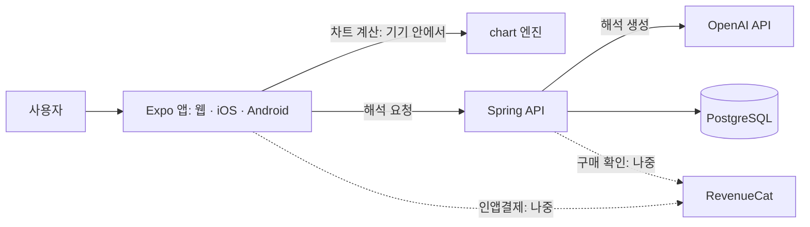

# 아키텍처

> 상태: 활성 · 기준 2026-11-10 · 구현 전 설계다. 코드가 생기면 `docs/codebase-map.md` 가 진입점을 맡는다.

## 구성

## 저장소 구조
- 앱 저장소(이 저장소) — Expo 앱(웹·iOS·Android)과 기획 문서. Expo 규칙은 `AGENTS.md`.
- 서버 저장소(별도, 같은 GitHub 조직) — Spring Boot 서버. AI 해석을 붙이는 시점에 만든다. 결정: docs/decisions/004-spring-backend.md
- 두 저장소는 서로의 코드를 import 하지 않고 HTTP API 로만 만난다.

## 모듈 경계 (src/features/)
- `chart/` — 차트 계산 엔진. 순수 함수만 둔다(입력: 출생 UTC 시각·위경도 → 출력: 행성 위치·하우스·애스펙트). 화면·네트워크·저장소를 import 하지 않는다. 이유: 계산 정확도가 제품의 신뢰이고, 기준값 테스트로 혼자 검증돼야 한다.
- `birth/` — 출생 정보 입력과 시각 보정(현지 시각 → UTC). 한국 표준시 변경·서머타임 이력을 여기서만 처리한다.
- `reading/` — 해석 요청·표시. 프롬프트는 서버에만 둔다.
- `synastry/` — 궁합. 두 차트 사이의 애스펙트 계산은 chart 엔진을 재사용한다.
- `purchase/` — 인앱결제(나중). 앱(iOS·Android)에서만 동작하고 웹에서는 "앱에서 열기"를 보여 준다.
- 디렉터리 표준은 `/agent-codebase bootstrap` 에서 ADR 로 확정한다. 위는 그 입력이다.

## 데이터 흐름
- 차트 계산은 기기 안에서 한다. 이유: 계산 라이브러리가 순수 JS 라 서버가 필요 없고, 입력 즉시 결과가 나온다. 결정: docs/decisions/003-chart-engine-astronomy-engine.md
- 해석 생성은 서버가 한다. 앱은 차트 JSON 을 보내고 서버가 OpenAI API 를 호출한다. 이유: API 키를 앱에 넣을 수 없다.
- 해석은 차트당 한 번 생성해 DB 에 저장하고 다시 읽는다. 이유: 같은 차트의 해석이 볼 때마다 달라지면 신뢰가 깨지고, 재생성은 비용이다.
- 서버는 앱이 보낸 차트 JSON 의 형식과 값 범위(황경 0~360, 천체 10개)를 검사한다. 이유: 차트를 서버에서 다시 계산하지 않으므로 잘못된 입력이 프롬프트로 그대로 들어간다.
- 결제를 붙인 뒤에는 유료 리포트를 서버가 구매를 확인한 뒤에만 생성한다. 앱이 보낸 "결제했음" 값은 믿지 않는다. 이유: 클라이언트 값은 조작할 수 있다.

## 비즈니스 룰
- 출생 시각 "모름"이면 정오 기준으로 계산하고 하우스·상승궁·달의 정확한 도수는 보여 주지 않는다. 이유: 시각이 없으면 상승궁은 계산할 수 없고 달은 하루에 약 13도 움직인다.
- 한국 출생 시각은 당시 표준시로 UTC 변환한다: 1954-03-21~1961-08-09 는 UTC+8:30, 서머타임은 1948~1960 일부 해와 1987~1988. 시간대 데이터베이스(Asia/Seoul)의 이력을 쓴다. 이유: 보정하지 않으면 상승궁이 틀린다.
- 하우스 분할은 플라시더스를 기본으로 한다. 이유: 서양 점성술 서비스의 사실상 표준이라 다른 서비스 결과와 비교할 때 어긋나지 않는다.
- 로그인 없이 차트와 요약 해석까지 본다. 기기마다 익명 계정을 발급하고, 소셜 로그인 연결은 나중에 붙인다. 이유: 가입 장벽이 첫 화면 이탈을 만든다.
- 사용자는 자기 차트·리포트만 읽는다. 서버가 모든 조회에서 소유자를 검사한다. 공유 링크는 추측할 수 없는 별도 식별자로 요약 해석만 노출한다.
- 출생 정보는 개인정보다. 로그에 남기지 않고, 계정 삭제 시 함께 지운다.

## 외부 시스템
| 시스템 | 용도 | 상태 |
|---|---|---|
| PostgreSQL | 프로필·해석 저장 | 서버 태스크에서 로컬 컨테이너로 시작. 운영 호스팅은 [확인 필요] |
| OpenAI API | 해석 생성 | [확인 필요] 키 미발급. 모델은 구현 시 확정 |
| RevenueCat | 인앱결제 상품·구매 확인 | 보류(결제를 붙일 때) |
| EAS | 앱 빌드·제출 | 미설정 |

## 관련
- 제품 범위: docs/product.md
- 결정: docs/decisions/
